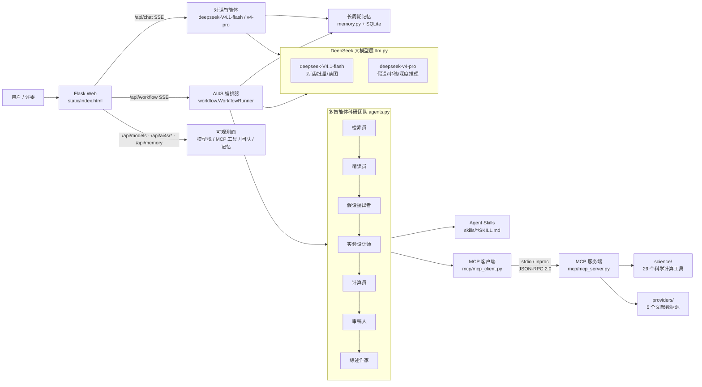

# 🔬 DeepSeek AI4S 科学智能体

> 基于 **DeepSeek 大模型（deepseek-V4.1-flash / deepseek-v4-pro）** + **MCP 协议** +
> **多智能体协同** + **长周期记忆**，做「搜 · 读 · 想 · 做 · 算 · 验 · 写」全链条的
> 科研智能体，跑通 **假设 → 实验 → 计算 → 验证 → 迭代** 的闭环。

面向 **兴智杯 · 方向 1：AI4S 科学智能体**。项目不是"接个模型查论文"，而是把一次
科学研究拆成可执行、可复核、可复现的九个步骤，并且**每一步的产出都带证据链**。

---

## 一、和赛题要求的对应关系（先看这张表）

| 赛题要求 | 本项目的落地 | 在哪看 |
|----------|--------------|--------|
| 必须基于 DeepSeek 大模型 | 主链路由 `core/llm.py` 统一到 DeepSeek API：`deepseek-V4.1-flash`（对话/批量/读图）、`deepseek-v4-pro`（推理/假设/审稿） | `core/llm.py`、`GET /api/models`、界面顶部模型徽章 |
| 搜：多源检索与筛选 | 5 个免费数据源并发 + 多检索式 + 跨源去重 + 相关度/影响力排序 | `providers/`、`workflow.step_search` |
| 读：长文本与科学数据理解 | 分批并发抽取；多模态读图（论文截图/谱图/分子结构/实验照片/PDF） | `workflow.step_extract`、`core/attachments.py`、`skills/multimodal-science-reading` |
| 假设生成与逻辑推导 | 可证伪假设：文献依据编号 + 变量 + **否定判据** + 预期结果 | `workflow.step_hypothesis`、报告第二节 |
| 实验/仿真方案设计 | 因子水平 + **真设计矩阵**（全因子/LHS）+ **真功效分析样本量** | `workflow.step_experiment`、`science/design.py` |
| 科学计算工具自主调用 | 29 个纯标准库科学计算工具，经 **MCP 协议**调用（统计检验/谱图/拟合/分子/设计） | `science/`、`mcp/mcp_server.py`、`mcp/mcp_client.py` |
| 结果可复现验证与迭代 | **重算比对**（用 repro 参数再跑一遍）+ 证据核查 + 独立审稿 → pass/revise/reject，revise 自动返工 | `core/workflow.py`、`tests/test_ai4s_loop.py` |
| 端到端闭环 | 九步流水线，中断可续跑，单步失败不拖垮全链路 | `core/workflow.py`、`POST /api/workflow` |
| 鼓励 MCP 封装科学计算工具 | `mcp/mcp_server.py`：stdio + JSON-RPC 2.0，`initialize`/`tools/list`/`tools/call`；外部 harness 可直接挂载 | `python mcp/mcp_server.py --list` |
| 鼓励多智能体分工 | 8 个角色（首席研究员/检索员/精读员/假设提出者/实验设计师/计算员/审稿人/综述作家），模型分层调度 | `core/agents.py`、`core/workflow.py`（角色与九步流程） |
| 鼓励 Agent Skills | 6 个 `SKILL.md`（文献调研/统计推断/谱图解析/假设设计/复现验证/多模态精读），按任务匹配后**只注入命中的技能** | `skills/`、`core/skills.py`（按任务匹配注入） |
| 鼓励上下文工程与长周期记忆 | 结构化研究记忆（目标/结论/排除/开放问题/偏好）+ 可解释召回 + 预算控制 + **"记忆≠证据"** 约束 | `core/memory.py`、`GET /api/memory` |

> 更细的逐条对照（含"评委怎么在 3 分钟内自己验一遍"）见
> **[`docs/赛题对齐说明.md`](docs/赛题对齐说明.md)**。

---

## 二、它到底能做什么（一条完整链路）

```
用户：帮我研究「图神经网络在遥感图像语义分割中的应用进展」

 搜  search      3 条互补检索式 × 5 个数据源 → 跨源去重 → 相关度+影响力排序
 读  extract     分批并发抽取 对象/方法/数据/指标/结论（含摘要里的关键数值）
 读  analyze     年份/被引/类型/来源分布 + 自动识别证据缺口（可核对的统计事实）
 想  hypothesis  从共识与缺口推出 1-3 条可证伪假设（依据[1][2]、否定判据、预期结果）
 做  experiment  因子与水平 → 真设计矩阵（2^k 全因子 / 拉丁超立方）+ 功效分析算样本量
 算  compute     MCP 调 stats_ttest / spectra_summary / molecule_parse…（真数值 + repro）
 验  verify      逐项重算比对（改一个数就会被抓）+ 证据核查 + 独立审稿 → pass/revise
                 revise → 带着返工意见回到「想」，最多 AI4S_MAX_ITERATIONS 轮
 写  synthesize  按主题归类写综述，只引用给定文献，标注局限
 写  format      GB/T 7714 参考文献 + 复现清单 + Markdown 报告
```

产物是一份 Markdown 报告，含：摘要 / 检索概况 / 科学假设 / 实验方案 / **计算结果（含 repro）** /
验证与迭代 / 综述正文 / 统计图表 / 信息抽取明细 / 参考文献 / **复现清单**。

**"复现清单"长这样**（报告第十节，别人照着能重算出同样的数）：

```
- `stats_ttest` ← 参数 `{"x": [82.3, 81.9, 82.8, 83.1], "y": [79.1, 78.8, 79.6, 79.9]}`
- `spectra_summary` ← 参数 `{"y": [0.05, 0.06, ...]}`
- 模型：DeepSeek / deepseek-V4.1-flash, deepseek-v4-pro
- 运行时：Python 3.13.7；工具经 MCP 协议调用（mcp/mcp_server.py），协议 2025-03-26
- 复现方式：python mcp/mcp_client.py stats_ttest '{"x": [...], "y": [...]}'
```

---

## 三、技术架构



### 目录

> **2026-10 目录整理**：源码按职责分到 `core/`、`web/`、`mcp/`、`cli/`、`scripts/`、`tools/`。
> 内部仍保留原来的扁平 `import`（`import llm` / `import providers`），由根目录的
> `paths.py` 在入口处把各分类目录加入 `sys.path`；单独 `python -c` 调模块时先
> `import paths` 即可。数据文件（`.env` / `accounts.json` / `literature.db`）与
> 虚拟环境（`.venv`）仍在项目根，路径没有变。

```
--main/
├── web/
│   └── app.py               # Flask 服务（SSE 流式 + AI4S 观测面接口）
├── core/
│   ├── llm.py               # DeepSeek 接入层（两个模型 / 思考切换 / 限流 / JSON 容错 / 自动退回）
│   ├── workflow.py          # AI4S 九步编排器（假设—实验—计算—验证—迭代 + 报告生成）
│   ├── agents.py            # 8 个角色的多智能体科研团队（职责/模型/工具/技能）
│   ├── agent_tools.py       # LangChain 工具定义（检索 / MCP 计算桥 / 记忆）
│   ├── skills.py            # Agent Skills 加载与匹配（按任务只注入命中的技能）
│   ├── memory.py            # 长周期研究记忆（可解释打分 / 预算控制 / 自动归档）
│   ├── accounts.py          # 账号存储（accounts.json，密码 bcrypt 哈希）
│   ├── database.py          # SQLite：用户 / 收藏 / 会话 / 工作流 / 研究记忆
│   ├── attachments.py       # 图片与 PDF（PDF 渲染成图，图片不落盘）
│   ├── runlog.py            # 运行日志（SQLite；管理员界面可查，不记内容）
│   ├── tts.py               # 朗读：edge-tts 合成 + Markdown 洗涤 + 本地缓存
│   └── env_boot.py          # 统一加载 .env（绝对路径 + 幂等）
├── mcp/
│   ├── mcp_server.py        # MCP 服务端（stdio + JSON-RPC 2.0）
│   └── mcp_client.py        # MCP 客户端（inproc / stdio / auto 三种传输）
├── cli/
│   └── Agent.py             # 命令行版（同一套模型与工具）
├── science/                 # 29 个科学计算工具（纯标准库，可复现）
│   ├── stats.py             #   描述统计 / t / Mann-Whitney(含 Cliff's δ) / ANOVA / 卡方 /
│   │                        #   Fisher 精确 / 单样本与两比例 / 相关 / 回归
│   ├── spectra.py           #   SG 平滑 / 峰检测（prominence+FWHM+面积）/ SNR / 基线
│   ├── curves.py            #   线性/指数/logistic/幂律/高斯 拟合、预测、外推
│   ├── molecules.py         #   手写 SMILES 解析 → 分子式/分子量/环/芳香/HBD/HBA
│   ├── design.py            #   全因子 / 拉丁超立方 / 功效分析 / 参数扫描 / 网格寻优
│   └── dataio.py            #   CSV / TSV / Markdown 表格解析
├── providers/               # 多源文献检索（S2 / OpenAlex / Crossref / Europe PMC / DOAJ）
├── static/index.html        # 单文件前端（聊天 / 论文卡 / 文献表 / AI4S 工作流面板）
├── skills/                  # 6 个 SKILL.md（方法论，可分发、可评审）
├── tests/                   # 2004 项检查，不依赖 pytest
├── docs/                    # 赛题对齐说明 / 公网部署 / Live2D 形象设定
├── scripts/
│   ├── launch.py            # 启动器（一键启动.bat 调用；中文提示都在这里）
│   ├── bootstrap_env.py     # 每次启动把 .venv 对齐到本机 Python（重定向/重建）
│   ├── check_env.py         # 环境自检（对方电脑跑不起来时先跑这个）
│   ├── check_deps_wheels.py # 依赖在 3.14 上是否有官方 wheel
│   ├── restart.ps1          # 干净重启（先清残留进程，再确认端口）
│   └── 打包分发.ps1         # 生成干净的对外压缩包
├── tools/view.py            # 小工具：打印数据库里的搜索历史
├── paths.py                 # 把分类目录统一加入 sys.path（保持扁平 import）
├── 一键启动.bat             # Windows 双击启动
├── requirements.txt / .env.example / .gitignore
├── accounts.seed.json       # 账号种子（进库）：空的 users 骨架，需要预置账号时复制成 accounts.json
├── accounts.json            # 账号（bcrypt 哈希）——**本地数据，不进版本库**
└── literature.db            # SQLite（收藏/会话/工作流/记忆）——本地数据，不进版本库
```

---

## 四、快速开始

### 1. 配置（只需填自己的 API Key）

`.env` **不进版本库**（放 Key 与会话密钥），新 clone 下来没有这个文件也没关系：
程序启动时会照 `.env.example` 自动生成一份，会话密钥取随机值。

最省事的方式是启动后点页面右上角的「🔑 填写 API Key」，粘贴保存即可，**立刻生效、不用重启**。
也可以手工复制模板并填写：

```bash
cp .env.example .env
```

```ini
DEEPSEEK_API_KEY=<DeepSeek API Key>        # https://platform.deepseek.com/api_keys
FLASK_SECRET_KEY=<随机 64 位十六进制>        # 不填会在首次启动时自动生成
CROSSREF_MAILTO=<你的邮箱>                 # 可选但建议：Crossref 礼貌池并发 3 而不是 1
```

配置加载顺序：`.env` → `.env.local`（后者覆盖前者）→ 系统环境变量优先。
只想临时改某一项时用 `.env.local`，不要动 `.env`。

### 2. 启动

```bash
python web/app.py
```

浏览器打开 `http://127.0.0.1:8000`。`python web/app.py` 会先用宿主 Python 对齐 `.venv`，再切到 venv 里启动；也可以用 `.venv\Scripts\python.exe web\app.py` 直接跑。`一键启动.bat` 只是可选封装，不需要它也能启动。PowerShell 里路径带括号时命令要加引号（见十·五③）。

启动横幅会**如实**打印当前模型栈：

```
==============================================================
   🔬 DeepSeek AI4S 科学智能体（搜 · 读 · 想 · 做 · 算 · 验 · 写）
   🌐 本机 http://127.0.0.1:8000
   🧠 模型后端：DeepSeek（深度求索）
      - 对话主模型  deepseek-V4.1-flash
      - 轻量批处理  deepseek-V4.1-flash
      - 多模态读图  deepseek-V4.1-flash
      - 深度推理   deepseek-v4-pro（思考开）
   🔧 MCP：31 个工具（科学计算 29 + 文献检索 2，inproc 传输）
==============================================================
```

没配 DeepSeek API Key 时站点照常打开：右上角「🔑 填写 API Key」填完即可；
聊天 / 润色 / 科研工作流会引导你先填 Key，不会甩一屏报错，也不会悄悄改用别家模型。

#### 第一次启动会先装依赖（屏幕上刷进度是正常的）

`.venv` 是空的时候（刚换机器、或者旧的被清理过），启动会先装一轮依赖。现在把过程全打出来，
不会只剩一行"正在自动安装..."让人干等：

```
📦 检测到缺失依赖: flask>=3.0.0, langchain, ...
   缺少 8 个依赖，正在安装（首次通常 1–3 分钟，装完后启动只要几秒）
       正在连接默认源…
       已连接，开始下载…
   ━━━━━━━━━━━━━━━━━━━━ 45%  (下载 langchain-core)
✅ 依赖安装完成
```

这一步**要联网**。连 PyPI 慢或超时的时候会自动换清华镜像再试一次，两次都失败才会报错，
报错里带着 pip 的原文和一条能直接复制的手动命令。

### 3. 命令行版

```bash
python cli/Agent.py
```

### 4. MCP 工具目录（不启动服务也能看）

```bash
python mcp/mcp_server.py --list      # 输出全部工具的 name/title/description/inputSchema
python mcp/mcp_client.py             # 握手 + 工具数 + 传输类型
python mcp/mcp_client.py stats_ttest '{"x":[1,2,3,4,5],"y":[2,3,4,5,7]}'
```

### 5. 跑测试

```bash
python tests/run_all.py
```

**故意不依赖 pytest**，只用标准库 —— 每个用例都是独立脚本，跑完打印
`N/M checks passed` 并以退出码表示成败，在没装任何测试框架的机器上（比如评委的环境）
也能直接验证。当前 **29 个 Python 用例 + 13 个前端用例，共 2004 项检查全绿**（另 4 项「老库升级」检查只在已存在 `literature.db` 时执行）。

---

## 五、九个步骤各自在做什么（以及为什么这么设计）

### ① 搜：多检索式 + 多源并发

单一检索式召回率低：查"图神经网络 遥感图像"会漏掉只写"GNN"或只写"高光谱"的论文。
规划器给 2-3 条互补检索式（中文式 / 英文式 / 近义术语式）分别检索，
按 DOI/标题跨源去重后重排 —— 实测召回能翻倍，代价只是多一轮并发请求（各源都有缓存）。

中文查询**不调用英文源**：S2/Europe PMC/DOAJ 对中文只做字面匹配，
实测查「经济」返回的是"煤层经济开采"和"施工现场管理"，反而把真正相关的中文文献挤下去。
所以中文走 OpenAlex(`language:zh`) + Crossref。

### ② 读：分批并发抽取

抽取按 8 篇一批，**批之间并发**（批次间无依赖，输出按 id 回填）。
实测 18 篇串行 6-7s，并发后 ≈ 最慢一批。中断语义保持在"批次边界"：
已发出的批次跑完照收，未发出的不再发。

### ③ 读（计量）：可核对的证据缺口

不靠模型判断"哪里缺研究"，而是用统计事实：
近两年文献占比为 0 → "最新进展缺失"；有 DOI 比例 < 50% → "可复现性受限"；
未报告数据集比例 ≥ 2/3 → "实验条件难以复现"。
这些缺口会作为**结构化输入**传给假设步骤 —— 假设因此不是凭空想的。

### ④ 想：可证伪假设

每条假设必须给：

* `basis`：文献编号（**校验必须落在已检索范围内**，越界会在验证步骤被抓）；
* `iv` / `dv` / `control`：变量要具体，不许写"环境因素"；
* `falsify`：**写出"观测到什么就否定它"** —— 写不出否定判据的不是假设，是愿景；
* `prediction`：含指标或方向的可测预期。

### ⑤ 做：真的设计矩阵与样本量

因子/水平由模型给，但**设计矩阵与样本量由工具算**：

* 2 因子 × 2 水平 → `design_factorial` 给 4 组全因子表；
* 更多因子 → `design_lhs` 给拉丁超立方（固定 seed=42，可复现）；
* 样本量 → `design_power`（按效应量算每组需要多少人，而不是模型随口说"每组 30"）。

### ⑥ 算：真数值 + 复现凭据

任务来源三路，按优先级：

1. **用户给的数据集**（最可信：CSV / 两列谱图数字 / SMILES 列表）；
2. **实验方案要求的计算**（模型自主决定，但**白名单校验** —— 只能调已注册工具）；
3. **文献元数据的确定性统计**（保底：被引分布、年份与被引的 Spearman、新旧 Mann-Whitney）。

每次调用都返回 `repro = {tool, args, python, case}`，验证步骤靠它重算。
**所有数字都来自工具，模型只说"算出来是多少"**，不许心算。

### ⑦ 验：重算 + 三查 + 独立审稿

三类检查，前四查是代码做的（不依赖模型）：

| 检查 | 做法 | 能抓什么 |
|------|------|----------|
| 数值一致性 | 用 `repro.args` **重新执行**一遍，比对结果（允许 1e-9 相对误差） | 报告里的数被模型改动过（测试里真的把 p 改成 0.0001，立刻判 revise） |
| 证据可追溯 | 每条假设的 `basis` 是否落在文献编号范围内 | 编造引用 |
| 假设可证伪 | 是否写了否定判据 | 空话型假设 |
| 可移交性 | 每项计算是否带工具名 + 参数 | "算过但没法重跑" |
| 审稿人（模型） | 独立 critic 角色给 pass/revise/reject + 可执行返工项 | 过度推断、把相关当因果 |

判定规则：**自动检查任一不通过 → 至少 revise**；模型说 revise/reject 也返工。
所以模型"护短"没用 —— 复算不一致一定拦得住。

### ⑧ 迭代

`revise` 时编排器带着返工项回到「想」，重新提假设 → 重新设计 → 重新算 → 重新验。
上限 `AI4S_MAX_ITERATIONS`（默认 1）。**到上限还没通过就如实写"未收敛"**，
并把返工项写进报告 —— 这是科研成果，不是缺陷。

### ⑨ 写：报告与复现清单

报告十节：摘要 / 检索概况 / 科学假设 / 实验方案 / 计算结果 / 验证与迭代 / 综述正文 /
统计图表 / 信息抽取明细 / 参考文献 / 复现清单。
**没有文献也要出报告**（说明失败原因），否则用户拿不到任何产物。

**综述这一步为什么要三级退让。** 综述要一次输出 5 个章节 + 共识 + 空白 + 局限，
而 `max_tokens` 是「思考内容 + 正文」**共用**的：真机上有一次 flash 先思考了 2698
个 token，正文写到第 3 节就被砍断（`finish_reason=length`），JSON 少了收尾的 `]`、`}`，
`json.loads` 必然失败 —— 用同样的提示词、同样的额度重试一遍，结果一样，整步判失败，
报告里就没有综述正文。所以现在的顺序是：

1. **整篇一次写完**（默认 7000 token，`AI4S_SYNTH_TOKENS` 可调）；
2. 被截断时**抢救已经写完的章节**（`llm.salvage_json` 补括号，只保留模型真写出来的部分，不编造）；
3. 仍缺章节就**逐节补写**（`AI4S_SYNTH_SECTION_TOKENS`，默认 3000），
   只补缺的那几节，已写好的不重写；最后把"缺了哪几节 / 是否逐节生成"如实写进报告与 `caveat`。

只有**一节都没写出来**才判 `failed` —— 这一步的失败语义没变，变的是"少一个括号就全废"
不会再发生了。判断依据是响应里的 `finish_reason`（见 `llm.last_finish()`），
不再靠猜。

---

## 六、DeepSeek 模型接入的细节（不是改个 base_url 就完事）

`core/llm.py` 是唯一的大模型出口。按需求只使用两个模型，界面上也只能选这两个：

| 模型 | 用途 | 角色 |
|------|------|------|
| `deepseek-V4.1-flash` | chat / fast / vision | 对话主循环、工具调用、批量抽取、读图 |
| `deepseek-v4-pro` | reason | 假设生成、复现校验、独立审稿（先推理再回答） |

几个实际处理过的点：

| 问题 | 处理 |
|------|------|
| DeepSeek API 用哪个地址 | `https://api.deepseek.com/v1`，兼容 OpenAI 的 chat/completions。URL 只写域名也会自动补 `/v1` |
| 为什么不直接用官方 SDK | 用 `langchain-openai` 指到 DeepSeek base_url：tool calling 与 `astream_events` 都是成熟的，不用自己实现 function call 解析 |
| 深度思考怎么实现 | **不传 `thinking_mode`**（DeepSeek 没有这个参数）。打开界面开关 = 本轮切到 `deepseek-v4-pro`；pro 会先输出 `reasoning_content`，再输出正文 |
| 思考内容会混进正文吗 | 不会。分片里 `tool_call_chunks` 非空的是**工具参数**，直接丢弃；`additional_kwargs.reasoning_content` 只用来推「模型正在思考…」状态 |
| 为什么调 JSON 不带 `response_format` | 为保持两个模型与兼容镜像的行为一致，仍用**宽松解析**：去 markdown 代码块 → 抓最后一个平衡的 `{}` / `[]` → **截断抢救**（补括号，保住已写完的字段），并允许重试（重试会换模型 + 抬高额度 + 追加"只输出闭合 JSON"的提示） |
| 限流怎么办 | 进程级令牌桶（最小间隔 = 60/RPM），匀速放行；429 用 `Retry-After` 或指数退避重试。一次工作流要 8-12 次调用，不控会被打断 |
| 为什么只有两个模型还要分四种用途 | 用途是"任务语义"，不是"四个模型"：批量抽取/读图都落到 flash，假设/审稿落到 pro。要换模型只改四个环境变量，代码里没有写死 |
| 换模型要改代码吗 | 不用，四个环境变量：`DEEPSEEK_MODEL` / `_FAST_` / `_VISION_` / `_REASON_` |
| 某个模型调不通怎么办 | 代码会在失败时**自动退回 flash** 重试一次，并记进 `/api/models` 的 `model_fallbacks`；界面会提示"所选模型未生效"，不会静默失败 |
| 怎么确认账号能用哪些模型 | `python -c "import paths, llm, json;print(json.dumps(llm.check_models(),ensure_ascii=False,indent=2))"`，或 `GET /api/models?check=1`。它是**按用途各真打一次**，不是只看 `/models` 列表 |

---

## 七、MCP 与 Agent Skills

### MCP：协议语义是真的

* **传输**：stdio 上换行分隔的 JSON-RPC 2.0（MCP 官方本地传输之一）与 in-process 两种，
  行为一致（同一个 `handle_request`）；`MCP_TRANSPORT=auto` 会先试 stdio，失败退回 inproc 并记录原因。
* **生命周期**：`initialize`（回协议版本 + capabilities + serverInfo）→
  `notifications/initialized` → `tools/list`（字段名是规范的 `inputSchema`）→ `tools/call`。
* **错误分开**：协议错误走 JSON-RPC `error`（-32600 / -32601 / -32602 / -32700）；
  **工具执行失败走 `result.isError = true`** —— 这是 MCP 与普通 RPC 最容易搞混的地方。
* **外部可用**：`python mcp/mcp_server.py` 即可被 Claude Code / openclaw / hermes 等挂载；
* **为什么手写而不是用官方 SDK**：官方 SDK 依赖较新的 pydantic/anyio，而本项目的底线是
  "装完 requirements.txt 就能跑"。MCP 的 stdio 传输本身只是换行分隔 JSON，不需要框架。

### Agent Skills：方法论可分发

`skills/*/SKILL.md` 用极简 frontmatter（name/title/description/keywords/roles/tools）+ 正文。
运行时按"研究目标 + 角色"匹配，**只把命中的技能注入上下文**（默认 2 个、2600 字预算）。
好处：① 上下文预算可控（不需要把 6 套方法论常驻）；② 技能可 diff/可评审；
③ 想加"质谱解析"能力加一个目录就行，不动 Python。

### 多智能体：为什么拆成 8 个角色

不是"显得高级"。单智能体做科研最致命的问题**是自我审查失效**：
写假设的那个"我"不愿否定刚写的假设。拆开之后：

* 检索员只说"找到了什么"，计算员只说"算出来是多少"，综述作家只能说"文献支持什么" ——
  越界会被下游格式要求卡住；
* 审稿人是**独立的模型调用**，看不到作者的自辩，只拿产物与证据，所以能真说"不成立"；
* 模型分层：批量抽取与读图用 flash，假设与审稿用 pro 深度推理。

---

## 八、长周期记忆：为什么不用向量库

赛题提到"上下文工程与长周期记忆"。这里存的是**结构化研究记忆**（目标/结论/排除方向/
开放问题/偏好），不是聊天记录（`conversations` 表已经有了）。

召回是**可解释打分**：`词面覆盖 × 1.6 + 时间衰减(半衰期180天) × 0.6 + 权重 + 命中次数`。
每条都能回答"为什么被想起来"，这在评审问起来时很重要；而几万条以内的个人研究记忆，
向量召回的收益远小于可解释性。

两个刻意的约束：

1. **记忆不等于证据**：拼进提示词时会带一句"这不是本次检索结果，引用前必须核实"。
   一个科学智能体如果把记忆当文献证据，就会开始编引用 —— 这是最坏的失败模式。
2. **写入幂等**：同一句话重复写入只涨权重，不会把记忆库刷满。

跑完一次工作流会自动归档：假设、验证结论、待解问题、研究空白、文献规模。
下次做同一课题时，`plan_workflow()` 会带着这些记忆去规划（界面会显示"本次规划参考了以往研究记忆"）。

---

## 九、API

### `POST /api/chat`（SSE）

请求体与以前一致（`message` / `history` / `conversation_id` / `source_pref` / `files`）。

| 事件 type | 含义 |
|-----------|------|
| `conversation_id` | 本轮会话 id（登录用户） |
| `status` | 阶段提示：正在思考 / 正在检索文献源 / 正在调用科学计算工具（真实计算） / 模型正在思考 / 正在生成回答 |
| `papers` | 结构化论文列表（前端渲染成卡片） |
| `calculation` | **新增**：科学计算的一次调用（tool / result / repro / 耗时），前端渲染成"计算卡" |
| `workflow_ready` | 已规划好 AI4S 工作流（方案卡 + 「开始执行」） |
| `token` / `done` / `error` | 增量文本 / 结束 / 错误 |

> `papers` 不只是画在屏幕上：它会跟这条 assistant 消息一起落库
> （`conversation_messages.papers`，JSON 文本）。打开历史对话时前端靠它把卡片
> **连原文链接一起画回来** —— 否则切走再切回来，论文就只剩正文里那串点不开的标题。
> 老库启动时会自动补这一列（`ALTER TABLE ... ADD COLUMN`，重复执行无害）。

### `POST /api/workflow`（SSE，需登录）

```jsonc
{"goal": "图神经网络在遥感图像语义分割中的应用进展"}                       // 新建
{"workflow_id": 12}                                                        // 断点续跑
{"workflow_id": 12, "papers": [...]}                                       // 人工修正文献后续跑
{"goal": "...", "dataset": "x,y\n1,2.1\n2,3.9", "dataset_kind": "spectra"}  // 带实验数据
```

`dataset_kind`：`table`（统计）/ `spectra`（谱图峰检测）/ `molecule`（SMILES 列表）。

事件：`plan`（含 `memory_used`、`team`）/ `step`（含 `iteration`）/
**`verdict`**（verdict + replay 一致数 + fixes + iterations）/ `snapshot` / `done`。

其它工作流接口：`GET /api/workflow/<id>`、`POST /api/workflow/<id>/interrupt`、
`DELETE /api/workflow/<id>`（都要求登录并校验归属）。

### AI4S 观测面

| 接口 | 作用 |
|------|------|
| `GET /api/models` | 模型栈（4 个用途的模型名、thinking 设置、限流、自动退回记录）+ `catalog`（界面下拉列表的 2 个可选模型与说明）；`?probe=1` 探活、`?check=1` 按用途真打一次 |
| `GET/POST/DELETE /api/memory` | 长周期记忆（列表/召回/写入/删除，需登录） |
| `POST /api/account/username` | 改用户名（3-24 位、查重、同步 session，需登录） |
| `POST /api/account/password` | 改密码（校验当前密码、新旧不能相同，需登录） |
| `POST /api/account/avatar` | 改头像（只收 data:image 的 data URL，≤200KB；空串=清除，需登录） |
| `POST /api/register`（可带 `avatar`） | 注册时直接带头像（同一套校验；前端先压到 128×128） |

其它既有接口：`/api/sources`、`/api/paper/<id>`、`/api/paper/<id>/pdf`、`/api/polish`、
收藏与对话记录接口。对话记录接口只多了一处：`GET /api/conversations/<id>` 返回的每条消息
带 `papers`（该轮检索到的论文，可能为空数组），前端据此把历史卡片重建出来。

---

## 十、界面

* **顶部模型徽章**：一眼看到当前跑的是 `DeepSeek deepseek-V4.1-flash` 还是未配置
  （纯展示，不可点）。
* **模型下拉列表**（输入框下方，默认 `DeepSeek-V4.1-Flash`）：**只有两个**模型可选，
  每项带说明：`deepseek-V4.1-flash`（NEW，快速通用 / 读图）与
  `deepseek-v4-pro`（深度推理）。选中的记在 localStorage，并随每轮请求以 `model`
  字段发出；服务端做**白名单校验**，陌生名字一律按默认跑。发图片/PDF 自动切到
  `deepseek-V4.1-flash` 并在界面写明原因。**界面不猜权限**：万一某个模型
  调不通，服务端自动退回 flash 重试一次，并在 `/api/models` 的 `model_fallbacks`
  留痕、界面提示"所选模型未生效"，不会静默失败。
* **深度思考开关**（模型选择旁边，默认关）：DeepSeek 没有 `thinking_mode` 参数，
  所以这个开关的语义是**切到 `deepseek-v4-pro`**：开了之后每轮请求带 `thinking: true`，
  服务端把本轮模型换成 pro（`DEEPSEEK_THINKING_MAX_TOKENS` 把额度抬到 4096，
  否则推理会把正文挤空）。打开开关时下拉列表也会同步选中 pro，关掉时切回 flash，
  界面与实际请求保持一致。pro 同样支持分片流式，推理阶段会先推「模型正在思考…」状态。
* **强制中止**：思考中时发送按钮保持可点（显示「思考中...」），鼠标悬停提示
  「再次点击中止思考」；点它或点「正在思考…」气泡都会立刻断开前端 SSE，
  并通过 `/api/chat/abort` 让服务端取消 asyncio 任务；被中止的这轮不落库、不写记忆。
* **「思考中」一定解得开**（修过的一个事故：回答输出完了按钮还卡在「思考中...」，
  输入框被锁，切到别的对话分支也发不出去）。三条一起保证：
  ① 结束以服务端的 `done` 事件为准，**不等连接关掉**（真实环境里连接常被内核/代理一直挂着）；
  ② 解锁写在 `finally` 里且认 `requestId` —— 中途抛异常也解得开，被切走的那一轮
  也不许动新一轮的界面；③ 服务端每 10 秒发一次 SSE 心跳（`CHAT_HEARTBEAT_SECONDS`），
  前端连续 45 秒收不到任何字节就主动结束等待（并把已生成的内容保留在上面）。
  切走的那一轮**不会被中止**，服务端跑完照常落库，切回这个分支还能看到完整回答。
  回归用例：`tests/test_chat_stream_state.js` + `tests/check_chat_stream_browser.js`。
* **删会话是幂等的**（修过的另一个事故：思考进行中删会话，聊天里堆出一串
  「助手：❌ 会话不存在」）。会话没了就不该在聊天里报错：重复删除（另一个标签页
  已经删了 / 连点了两下）服务端直接回 success 并标 `already`，前端遇到 404 只把这条
  记录从侧栏移除；**删除"正在回答"的那个会话会把这一轮一起中止** —— 否则模型会
  继续为一段已经不存在的对话出字，白烧额度。另外切回标签页时会重新拉一次会话列表，
  免得侧栏一直挂着早已删掉的旧记录。回归用例：`tests/test_conversation_delete.py`
  + `tests/test_chat_stream_state.js`（浏览器场景 3）。
* **聊天气泡带圆形头像**：用户消息显示**自己上传的头像**；没上传过就用
  「昵称首字 + 主题色圆底」（换蓝/红/黑会一起变）；助手消息用固定的**默认剪影头像**。
  头像在注册时就能顺手传（可选），也能在「设置 → 账号管理」里换。
* **⚙️ 设置（头部独立按钮，与「功能」并列）**，两个分支：
  * **通用**：主题颜色（蓝 / 红 / 黑）、外观（浅色 / 深色 / **跟随系统**）、
    功能面板显示方式（单独小窗 / 显示在对话框）。偏好存 localStorage，
    并在 `<head>` 里用一个极小的脚本**先于样式**应用，刷新不会先闪一下浅色。
  * **账号管理**：改**头像**（前端裁成 128×128 再传，存 data URL，别把几 MB 原图塞进库）、
    改**用户名**（3-24 位，允许中文，查重并同步 session）、改**密码**（必须校验当前密码，
    新旧密码不能相同）、**登出**。未登录时分支只显示"去登录"，不摆一个交了会 401 的表单。
* **五个功能收进头部右侧的一个「🧩 功能」下拉**（收藏 / 文献表 / 名词解释 /
  润色 / 科研工作流）。以前是五颗胶囊平铺，窄屏会把顶栏挤爆；现在只占一颗按钮的宽度，
  菜单项显示名称 + 一句说明，当前开着的功能带 `is-open` 底色与「已打开」标记。
  菜单用 `.feature-wrap` 相对按钮定位；点外面、按 Esc、选了菜单项都会收起
  （Esc 的顺序：询问框 → 设置 → 功能菜单 → 侧栏面板）。
  「⚙️ 设置」仍在左下角侧栏底部。点功能**先弹一个小询问框**：
  「单独小窗」还是「显示在对话框」，选完才打开面板。
* **新对话首页的「猜你想搜」**：随机 4 条研究题目（池子 `GUESS_POOL` 共 20 条），
  点一下就把这句话填进输入框**并直接发送**；正在回答时只填不发送（避免打断上一轮）。
  每次回到空白页（新对话 / 切会话）都会重新抽 4 条，不会一直是同一组；
  排版固定成 **2×2 两列等宽**（不是按文字长短自动折行，避免出现 3+1）。
  * 询问框里有 **「不再询问」**：勾上就把这次的选择记下来（localStorage `panelModeAsk`），
    以后直接按它打开；想恢复询问去「设置 → 通用 → 功能面板显示方式」点「恢复询问」。
  * **名词解释**（第五个功能，也在「功能」下拉里）：读论文卡住时输入术语即可，
    可选贴一句原文帮助判断语境；返回「一句话定义 / 通俗解释 / 在论文里的含义 /
    相关概念 / 常见误解」，可一键复制或「发送到对话」继续追问。
    更顺手的入口是**在论文卡片里划词**：选中一个词会浮出「📖 解释」按钮，
    直接**右键**也能触发——面板会带着这个词和这篇的标题+摘要自动跑一次。
    接口 `POST /api/term` 不要求登录（阅读辅助），但术语 ≤60 字、原文 ≤1200 字；
    走轻量模型槽位（`fast`），拿不准时要求模型明说"不确定"而不是编造。
  * 小窗：原来那种浮在右侧、可拖可缩的卡片。
    **窄屏（≤1830px）会自动改成"右侧浮窗"**：锚右、给足 390px 宽、顶边让开工具栏、
    底边停在输入框上方——不然列宽会被算成几十像素，面板变成右上角的一条，
    标题栏窄到只剩关闭按钮，看起来"卡住、拖不动"。

  * 内嵌：面板**整面覆盖对话区**（从头部下面一直铺到输入框，不做上下分栏、
    也没有任何拖动条），用 **VS Code 风格标签页**管理（同一份 DOM 只是换了宿位）：
    打开多个功能会各占一个标签，点标签切换、点标签上的 ✕ 关闭；
    内嵌状态下自动禁掉拖动/缩放抓手。
  * 内嵌面板自己滚（`.panel-scroll` 是唯一的滚动容器），长报告不会再被裁掉；
    因为覆盖整面，**点左侧历史对话 / 新建对话时会自动收起内嵌面板**，
    对话立刻整面可见（工作流该跑还在跑，再点一次功能接着看）。

* **弹窗都能拖、能缩**：四个右侧面板（收藏 / 润色 / 文献表 / 科研工作流）
  按住**标题栏**可以拖走，拖 **右下角**可以缩放（右边只改宽、下边只改高），
  双击右下角恢复默认；大小按面板记在 localStorage 里，下次打开还是这个大小（**宽度不超过弹窗列**；想更大就拖右下角缩放，缩放后位置与尺寸都保留）。
* **未登录点「润色」会先提示登录**，提示框里的「立即登录 / 注册」会直接把左上角
  登录浮层打开并高亮（焦点落在用户名框），不用自己去找入口。
* **摘要润色**（`POST /api/polish`）：**重写，不是校对**。提示词硬性要求逐句换结构、
  具体化、显式逻辑、可控的画面感，并禁止编造原文没有的数字；返回前服务端再算一遍
  「整体相似度 + 句子复用率 + 是否新出现数字」，不合格就带着针对性提示重试一次。
  结果附「改动说明」与「改写幅度」；五种风格：学术正式 / 精简紧凑 / 清晰易懂 /
  **生动有画面感** / 强化逻辑。走主模型（fast 槽位改写偏保守，容易只换同义词）。
* **账号只注册一次**：账号信息（昵称 / 密码哈希 / 头像）存在项目目录的
  **`accounts.json`**（明文放不进这个文件，密码只存 bcrypt 哈希），重启服务后
  **直接登录即可**；登录框还会列出「本机已注册的账号」，点一下就填好用户名。
  收藏 / 对话记录 / 研究记忆仍在 `literature.db`。
  **这两个文件都是本地数据、都不进版本库**（`accounts.json` 每次注册/登录都会改写，
  跟踪它会让工作区天天变脏）；新克隆时它不存在是正常的，登录页注册或点
  「一键生成账号」即可。要预置账号就复制 `accounts.seed.json` 再改。
* **保持登录**：登录框默认勾选「记住我」，cookie 带 30 天有效期（`LOGIN_DAYS` 可调），
  关掉浏览器/重启服务再打开仍是登录态。本机演示想彻底免登录可以设 `DEV_AUTO_LOGIN=<用户名>`
  （只对回环地址生效）。
* **🤖 AI4S 工作流面板**：九步实时状态（含"第 N 轮"迭代徽章）、假设卡、实验方案卡、
  计算卡（真实数值 + repro）、验证卡（pass/revise/reject + 检查项 + 返工项 + 迭代记录）、
  综述、统计图、参考文献、报告导出、**可选粘贴实验数据**。
* **聊天**：论文卡片、计算卡、方案卡；阶段提示含"正在调用科学计算工具"。

---

## 十·四、管理员控制台与运行日志

`/admin/` 是**隐藏路由**（任何界面里都没有入口，只能手敲地址；不带斜杠会被弹回首页）。
账号密码默认 `admin` / `admin`，可用 `ADMIN_USER` / `ADMIN_PASSWORD` 覆盖。
普通用户登录状态下访问会直接回首页，不进控制台。

里面两个标签页：

* **用户总览**：ID / 用户名 / 邮箱 / 注册时间 / 最后登录（读 `accounts.json`，密码哈希不显示）；
* **运行日志**：按 **级别 / 模块 / 关键词** 过滤、分页、5 秒自动刷新、一键清空。

日志落在 SQLite 的 `app_logs` 表（`core/runlog.py`，惰性建表，老库不用迁移）：

| 记什么 | 例子 |
|--------|------|
| 请求 | `GET /api/models → 200（12ms）`，带状态码、耗时、IP、用户 id |
| 认证 | 登录成功 / 失败（带用户名与是否本机）、注册、登出、管理员登录 |
| 问答 | `收到问答：23 字` / `问答完成：23 字问题 → 412 字回答，5 篇文献`（带模型、耗时、是否调用工具） |
| 研究流程 | 新建/续跑、结束状态（done/failed/interrupted）、verdict、迭代轮次 |
| 异常 | 未捕获异常记 ERROR，附异常类型与栈的最后几行 |

**两条刻意的约束**：

1. **不记内容**：只记长度、数量、状态与耗时，不记问题原文、不记密码、不记 token
   —— 管理员能看出负载与异常，但读不到别人问了什么；
2. **绝不拖慢业务**：所有写入都是 best-effort，写失败只往 stderr 打一行然后忽略，
   并且只保留最新 20000 条（`APP_LOG_MAX_ROWS` 可调，每写 200 条清一次旧行）。

给脚本/外部用的接口（都要管理员会话，否则 403）：

```bash
GET    /api/admin/logs?level=ERROR&module=chat&q=超时&page=1&size=50
DELETE /api/admin/logs          # 清空
```

## 十·五、换台电脑 / 发给别人怎么跑

压缩包发给别人后最常见的三个坑，都在这儿堵住了：

### ① 别把 `.venv` 一起发过去

虚拟环境里写死了**本机的绝对路径**（`pyvenv.cfg` 里的 `home`）和编译好的二进制，
换台机器、换个 Python 版本容易报错，还平白多出上百 MB。打包脚本默认排除 `.venv`。

现在 `一键启动.bat` 每次启动都会先跑 `scripts/bootstrap_env.py`：

* **同一 major.minor**：只把 `pyvenv.cfg` 的 `home` / `executable` 重写成**当前主机**的 Python；
* **版本不同或 venv 真坏了**：用当前 Python 重建，依赖由 `scripts/launch.py` 重新安装。

所以目标机只需要装 Python 3.10+；就算 `.venv` 被一起拷过来，也会自动修好。
重建采用「先建 `.venv.new`、验证通过再替换」的方式，失败不会弄丢原来的 `.venv`。

### ② 别把 `.env` 一起发过去（这是泄露 API Key）

`.env` 里有你的 `DEEPSEEK_API_KEY`。**如果之前发过带 `.env` 的包，请去
<https://platform.deepseek.com/api_keys> 把这个 key 停用并重新生成一个。**
`literature.db` 同理：里面有账号密码哈希、收藏、对话记录，不适合外传。

### ③ PowerShell 里路径带括号必须加引号

对方看到的报错：

```
& : 无法将"c:\code\论文助手\兴智杯"项识别为 cmdlet、函数、脚本文件或可运行程序的名称。
```

这不是 Python 的问题，是 **PowerShell 把 `兴智杯(1)` 里的 `(1)` 当成了语法**
（括号在 PowerShell 里是分组），于是只解析到 `兴智杯` 就断了。两种解法：

```powershell
# 解法 1：给路径加引号
& "C:\code\论文助手\兴智杯(1)\兴智杯\--main\.venv\Scripts\python.exe" "C:\code\论文助手\兴智杯(1)\兴智杯\--main\web\app.py"

# 解法 2：先 cd 进去，再跑（最省事）
cd "C:\code\论文助手\兴智杯(1)\兴智杯\--main"
.\.venv\Scripts\python.exe web\app.py

# 解法 3（推荐）：直接双击 一键启动.bat，不用敲路径
```

> 顺带一句：目录名 `--main` 以两个减号开头，有些命令行工具会把它当参数，
> 能改名就改成 `main` 更省心。

### ④ 对方是 Python 3.14 也没问题

本项目 37 个依赖在 3.14 上**全部有官方 wheel**（纯 Python / `cp314` / `abi3`），
不需要编译器。想自己复验：

```bash
python scripts/check_deps_wheels.py      # 查 PyPI：每个依赖在 3.14 上有没有 wheel
```

结论表（2026-10 实查）：

| 类型 | 包 |
|---|---|
| 纯 Python（任何版本） | flask, langchain, langchain-core, langchain-openai, langchain-deepseek, requests, python-dotenv, pydantic, openai, httpx, langgraph, langsmith, tenacity 等 |
| 有 `cp314` wheel | bcrypt, pydantic-core, orjson, tiktoken, pyyaml, regex, uuid-utils, zstandard, jiter, xxhash, ormsgpack |
| 有 `abi3` wheel（3.14 可用） | pymupdf |

### ⑤ 三个开箱工具

| 文件 | 作用 |
|---|---|
| `一键启动.bat` | 双击即用：找 Python → 对齐/按需重建 venv → 装依赖 → 自检 → 启动（纯 ASCII + CRLF，避开 cmd 的中文/行尾坑） |
| `scripts/check_env.py` | 环境自检：Python 版本、依赖、`.env`、端口、目录完整性，问题都带修复命令；结果写 `诊断结果.txt` |
| `scripts/打包分发.ps1` | 生成干净压缩包：自动排除 `.venv*` / `.env` / `literature.db` / 缓存日志，并附带一份《拿到先看这个》 |

```powershell
powershell -ExecutionPolicy Bypass -File .\scripts\打包分发.ps1     # 默认输出到桌面
```

## 十·六、朗读（把回答念出来）

每条**助手回答**下面挂一个很淡的「🔊 朗读」按钮：点一下开始念，再点停止；
合成期间显示「◌ 生成中…」，播放中整颗按钮变成蓝色的「停止」。
按钮默认 78% 透明度、鼠标移到这条消息上才完全浮现，因为朗读是"想听时才找"的功能。
它只挂在回答上 —— 用户的提问、还在"正在思考"的卡片、只有图片的消息都没有。

`设置 → 朗读 → 音色` 里两档：**晓晓**（女声）、**云希**（男声），都是微软 Edge 的
在线中文神经语音（`edge-tts`）。36 个字的回答实测 **2.3 秒**出 49 KB mp3，
同一段再点一次是 `cached: true, ms: 0`（直接读本地文件）。

没装 `edge-tts` 时整块朗读入口自动隐藏，不会留一个点了必失败的按钮。
代价是**要联网，且正文会发到微软** —— 不想发出去就别点朗读。

> 早先还接过一档 RVC 音色（「沃雅妮莎」：先合成基础音，再用 torch + faiss 换音色）。
> 实测 CPU 上 6 秒音频要转 5.7 秒、首次还要多等 4 秒加载模型，为了"稍微个性化一点"
> 付这个代价不划算，已整档删除（`tts_rvc/`、`scripts/setup_rvc.py`、`.venv-rvc`、
> `models/` 全部移除），设置里只剩两档在线音色。

### 念之前先把文本洗干净

屏幕上的 Markdown 直接念会很难听，`core/tts.py:strip_markdown()` 的取舍：

| 删掉 | 为什么 |
|------|--------|
| 代码块整段 | 念 `def foo(x):` 没有意义 |
| 表格竖线 → 顿号 | 否则会念出"竖线" |
| 标题井号 / 分隔线 / 列表符号 / 引用箭头 | 视觉元素，念出来是噪音 |
| `[1]` `[2,3]` 这类引用角标 | 念编号没有信息量 |
| emoji | 多数语音会把 😊 念成"微笑" |

**保留** `[p值 = 0.03]` 这种带内容的方括号 —— 统计值必须念出来。
超过 1000 字（`MAX_CHARS`）会截断，且**断在句号/换行处**并补一句"后面还有内容"，
不会读半句话，也不会让浏览器读十分钟。

### 同一段话再听一次是秒开

合成结果按 `sha1(音色 + 语速 + 正文)` 落盘到 `tts_cache/`，文件名就是 `<20 位十六进制>.mp3`。
这个命名规则同时被当作 `/api/tts/audio/<name>` 的白名单（正则 `[0-9a-f]{20}\.mp3`），
所以不存在 `../` 穿越。缓存超过 300 MB 按最久未用删到 80%。

### 接口

```bash
GET  /api/tts/options     # 有哪些音色、能不能用、不能用的原因（不要求登录）
POST /api/tts             # {text, voice?, rate?} → {url, cached, chars, ms}（要登录）
GET  /api/tts/audio/<20位hex>.mp3    # 取音频（要登录）
```

`rate` 支持 `-20% / -10% / +0% / +10% / +20%`（接口已通，设置面板暂时只暴露音色）。

## 十一、测试（2004 项检查）

| 用例 | 覆盖 | 检查数 |
|------|------|--------|
| `test_ai4s_loop.py` | 九步闭环、假设可证伪、设计矩阵/样本量与工具交叉核对、**篡改数值被抓**、迭代回环与上限、模型全挂时的降级、用户数据集、中断 | 82 |
| `test_science_tools.py` | 科学工具的数值正确性（t/ANOVA/卡方/Fisher/比例/相关/回归/峰检测/SG/拟合/SMILES/设计） | 276 |
| `test_mcp.py` | MCP 握手、`tools/list` 字段名、`isError` 语义、错误码、**stdio 子进程真算** | 55 |
| `test_memory.py` | 打分与召回、预算截断、"记忆≠证据"约束、幂等、归档、遗忘 | 44 |
| `test_llm.py` | 默认就是 DeepSeek、只允许两个模型（环境变量也不能绕过）、界面名→API 模型 ID 映射、深度思考切 pro、请求体不带 `thinking_mode`、JSON 容错、限流、**pro→flash 自动退回**、`check_models` | 109 |
| `test_workflow.py` | 规划与缓存、GB/T 7714、全流程、中断/续跑/跳过、单步失败隔离 | 63 |
| `test_workflow_api.py` | 工作流 SSE、落库、续跑、人工修正、鉴权、限流降级 | 50 |
| `test_interrupt_resume.py` | 步骤内/步骤间中断、断点唯一、跨会话续跑 | 28 |
| `test_chat_route.py` | 聊天 SSE、论文卡片、任务移交、回答非空、思考状态、**流一定有终结事件 + 心跳 + 共用事件循环不被打断 + 无分片时也能从 `on_chat_model_end` 拿到正文** | 81 |
| `test_accounts_file.py` | **账号文件存储**：注册/改名/改密/改头像落到 accounts.json、密码非明文、重启后仍在、原子写、坏文件容错、旧库迁移、测试不污染真实账号 | 41 |
| `test_local_accounts.py` | **注册即登录、重启后仍可登录、记住我（持久 cookie）、本机账号列表不泄露密码、非本机不返回账号列、密码是 bcrypt 哈希** | 33 |
| `test_account_settings.py` | 改用户名/改密码/改头像、未登录拦截 | 33 |
| `test_agent_handoff.py` | 对话 → 工作流移交工具 | 19 |
| `test_new_sources.py` | Crossref/Europe PMC/DOAJ 字段归一化与相关度规则 | 79 |
| `test_streaming.py` | 流式推送（首个事件不等到最后）+ 抽取并发 | 12 |
| `test_smoke.py` | 静态白名单、鉴权、跨用户隔离 | 40 |
| `test_migration.py` | 老库升级补新表（含 research_memory）；无旧库时跳过 | 4 |
| `test_env_config.py` | **环境变量加载**：`.env` / `.env.local` 被忽略、模板进库、缺失时自动生成、覆盖顺序、没有 Key 时的提示可照做 | 21 |
| `test_bootstrap_env.py` | 启动引导：`pyvenv.cfg` 重定向、同/跨版本判断、**先建 `.venv.new` 再替换**、失败不弄丢原 venv | 27 |
| `test_startup_deps.py` | 启动体验：缺依赖时 pip 输出**不再被吞**（有进度、有镜像重试、有手动命令兜底）、装完再验证一遍、**GBK 控制台重定向时 emoji 不再把启动打崩** | 16 |
| `test_exposure.py` | 公网暴露面（源码不外泄/密钥/口令门禁） | 38 |
| `test_attachments.py` | 图片/PDF 校验、渲染、多模态装载、不落盘 | 52 |
| `test_history_papers.py` | **历史对话论文卡片**：papers 往返、坏 JSON 容错、老库自动补列、`/api/conversations` 带出 | 19 |
| `test_conversation_delete.py` | **删除会话是幂等的**（重复删不再回 404「会话不存在」）、跨用户删不掉、未登录仍 401、前端遇到 404 只移除记录不写进聊天 | 14 |
| `test_runlog.py` | **运行日志**：写入与级别/模块/关键词过滤、分页、统计、清空、保留上限、请求自动埋点、**聊天日志不含问题原文**、管理员接口鉴权与清空 | 42 |
| `test_tts.py` | **朗读**：Markdown 清洗（代码块/表格/角标/emoji，保留 p值）、长文按句裁剪、参数归一与空文本报错、缓存键、音色清单、**RVC 那一层确已移除**、接口与前端接线 | 59 |
| `test_polish.py` | **摘要润色**：必须真的改写（原样返回自动重试一次）、句子级复用检测、编造数字拦截、三种风格回落与空结果 502 | 27 |
| `test_term_api.py` | **名词解释接口**：空/超长输入拦截、结构化字段归一化（`related` 字符串自动拆列表）、模型返回脏数据时 502、不需要登录 | 13 |
| 前端 ×13 | 分页/折叠、弹窗拖动、会话侧栏、附件、参考文献作者格式、面板缩放与登录门槛、模型下拉、**头部「功能」下拉** + 显示方式询问框 + 内嵌整面覆盖 + **名词解释面板**、历史对话重建论文卡片、设置与主题、聊天流收尾与会话删除、一键账号、**卡片划词解释**、窄屏浮窗与小窗归位、**猜你想搜（2×2）**、润色改写与改动说明、首次开窗尺寸 | 610 |

还有一个**真浏览器**自检（不属于 run_all，因为需要本机有 Edge/Chrome）：

```bash
python tests/check_panels_browser.py        # 起临时服务 + headless 浏览器，验拖动/缩放/登录门槛/询问框/内嵌覆盖与滚动
node tests/check_chat_stream_browser.js     # 验「回答输出完了按钮还在思考中」「思考中删会话」这几个事故
```

它验的是三个只有真实排版引擎才量得出来的东西：① 面板是 flex 子项、会被拉伸成
和容器一样大，所以可移动范围必须按**视口**算；② 只写 width/height 会被 flex 拉伸
覆盖，缩放前必须先钉成绝对定位；③ 点「立即登录」的事件会冒泡到 document，
被"点到别处收起浮层"的监听关掉（表现是"点了没反应"）。

`check_chat_stream_browser.js` 造的是另外几个只有真浏览器才复现得出来的条件：
**服务端发完 `done` 之后不关连接**（真实环境里连接常被内核/代理一直挂着）、
回答还在流时切分支、以及思考进行中删掉正在回答的会话。三个场景分别断言：
按钮回到「发送」、输入框解锁、旧分支跑完不污染新分支、删会话不再堆出
「❌ 会话不存在」。修复前只跑前两个场景时是 2/7（前两个场景几乎全挂）；
第三个场景在没有 404 兜底时，会在聊天里留下一串「❌ 会话不存在」。

三个**真机**脚本（需要 `.env` 里配好 key，会真实调用模型与数据源）：
`tests/live_run.py`（工作流全流程）、`tests/live_chat.py`（聊天接口）、
`tests/live_stream.py`（对运行中的服务量 SSE 到达时间线）。

所有测试都在临时库上操作，**不会碰 `literature.db`**。

---

## 十一·五、接 DeepSeek 后，实机跑出来的七个坑（都已修）

这一节是接入真机后**实际踩到并修好**的问题。评审自己跑一遍也会遇到同样的现象：

| 现象 | 根因 | 修法 |
|------|------|------|
| `python -c "import paths, llm; llm.check_models()"` 说自己没配 token | `.env` 只在 `web/app.py`/`cli/Agent.py` 里加载，任何"直接 import"的入口都读不到 | 抽出 `core/env_boot.load_project_env()`（绝对路径 + 幂等 + 不覆盖已有环境变量），由 `core/llm.py` / `providers/__init__.py` 在 import 时自己调用 |
| 聊天回答里冒出一大段推理内容 | 推理模型把思考写在独立的 `reasoning_content` 里；如果前端把 `additional_kwargs` 也当正文拼进去，用户会先看到一屏"思考" | 只把 `content` 当正文；`reasoning_content` 只用来推「模型正在思考…」状态 |
| **流式一个字都收不到** | `ChatOpenAI` 默认 `streaming=False`，`astream_events` 就不会产生分片 | 聊天/命令行显式 `streaming=True`；DeepSeek 的 flash / pro 都支持流式 |
| **同一进程里聊第二轮就失败**（前端显示"本轮没有收到回复"），服务端只有一行 `RuntimeError: Event loop is closed` | 每轮 `asyncio.run()` 新建一个事件循环：上一轮留下的 httpx 连接会在**下一轮的新循环里**被 GC 回收，回收时去 close 那个已关闭的旧循环，Windows 的 proactor 传输层直接抛异常，把正在跑的下一轮打断（实测隔一轮挂一次） | 全进程共用一个常驻事件循环（`_agent_loop()`）；并且任务里的 `BaseException` 一律接住 —— 否则一个 `KeyboardInterrupt` 会把循环带走，之后**所有**请求都挂到 240 秒超时 |
| **同一个问题问第二遍，界面没有论文卡片**，只有一段纯文本（右侧还冒出个"收藏此论文"） | 上下文里已经有上一轮的论文清单，模型有时直接复述，不再调用 `search_papers` —— 没有工具调用就没有 `papers` 事件，前端只能退化成纯文本 | 提示词写死："**即使上一轮检索过同样的题目，这一轮也必须重新调用**（命中本地缓存，不会真的重复打源），不许把历史清单当成本轮检索结果" |
| **勾上「深度思考」后，不管问什么都只回一句「抱歉，未能获取到回复」**，正常对话反而消失 | 某些模型/网关在推理模式下不产生 `on_chat_model_stream` 分片，而服务端只从分片累计正文 → 整轮一个 token 都没有 | 增加 `on_chat_model_end` 分支取正文（`_text_from_message`），收尾时只在"一个分片都没收到"的情况用它，流式不会重复；工具结果与 `papers` 事件不受影响 |
| 假设/审稿跑很久，最后还是"降级" | ① `HYPOTHESIS_PROMPT`（含 JSON schema）没被传进提示词 → 模型写了 4000 字 Markdown；② pro 的推理把 `max_tokens` 吃光、JSON 被截断 | ① `_role_json` 现在把"任务契约 + 角色技能"一起送进去；② 重试改成**换策略**（改用 flash + 抬额度），不再同参数再烧一遍 |

另外三处是被"审稿人"自己骂出来的（也修了）：

1. **假设与证据不匹配**：没有实验数据却提"GNN 的 mIoU 更高" → 验证必然判"证据不支持"。
   现在把「文献字段可得性」的**真数字**（如"报告数据集 18/53、抽到指标数值 2/53"）交给模型，
   并硬性约束："指标数值不足 6 篇时，不要提需要逐篇比较数值的假设"。
2. **设计与计算之间缺数据绑定**：设计只能声明"对 H1 做 Mann-Whitney"，参数却是空数组
   `{"x": [], "y": []}` → 5 个计算全失败。现在有 `_auto_hypothesis_tasks()`：
   用文献字段（是否报告数据集 / 方法是否 GNN / 是否开放获取 / 年份切分 / 方法关键词）
   **真的把分组构造出来**再跑检验，结果标注 `source=auto-derived`。
3. **审稿人吹毛求疵**：要求 Fisher / 两比例 z / Cliff's δ 才算"做过"。现在
   ① 工具层真的补了 `stats_fisher`、`stats_proportion_two`、Mann-Whitney 的 Cliff's δ；
   ② 提示词写明"等价检验算已满足"（卡方≈Fisher、单样本二项≈两比例 z 的特例、
   Welch t≈Mann-Whitney），且 Fisher 不需要期望频数。

**耗时**：与账号额度、网络、文献数量强相关（一次工作流要 8-12 次模型调用）。
本项目附了 `tests/live_run.py`，在真实 key 下可以量出你这台机器上的单轮耗时；
流程本身不依赖某个固定数字。

> 关于 `reject`：检验结果不显著时审稿人会给 `reject`。这不是流程失败 ——
> 报告里写的是"本轮假设在现有证据下未被支持（负结果）"，并给出下一步该问什么。
> 一个科研智能体如果永远只报"结论成立"，那才是真有问题。

---

## 十二、实测与取舍（都是量出来的，不是照抄文档）

> 下面这张表是数据源与流程层面的量化结论，用来说明"性能账是怎么算的"。
> 模型耗时与账号/网络强相关，换机器后建议用 `tests/live_run.py` 复测；
> 差异主要来自模型出字速度与"任务长度 × 调用次数"，而不是流程设计变了。

| 结论 | 依据 |
|------|------|
| Crossref 不带 `mailto` 掉进公开池（并发 1），并发检索必 429 | 响应头配额实测；带 mailto 进礼貌池并发 3 |
| Crossref 的 `is-referenced-by-count` 不可信（常为 0） | 多家出版商未提交；所以**不拿它当影响力指标**，如实给 0 |
| Semantic Scholar 是 5 个源里最慢的（实测 8.3s），其余 1.5-2.3s | 接源时逐源打点 |
| 中文查询不该拉英文源 | 查「经济」返回"煤层经济开采""施工现场管理"，与经济学无关 |
| 抽取并发度 3 最合适 | 2 批 16 篇 0.8s → 0.4s；再高对接口与本地都没好处 |
| 规划要 1.5-1.9s，值得缓存 | "续跑/重复点开始"目标字符串一样，缓存后整条 12.6s → 10.3s |
| 综述生成 7.1s 是模型出字速度下限 | 拆分成多次并发会失去"一份完整上下文"，那种"快"是假快 |

**没有为了好看牺牲诚实**：模型不可用时假设步骤降级并标 `degraded: true`；
综合检查不过就判 revise；迭代不收敛就写"未收敛"；没有文献也生成说明性报告。

---

## 十三、局限（说清楚比藏起来好）

1. **中文核心期刊覆盖**不如知网/万方（后者不开放个人 API 或需商务授权）。
   当前中文源是 OpenAlex + Crossref，不少中文文献没有摘要。
2. **"实验"是仿真/复现实验**，不是真做湿实验。谱图/曲线/分子数据需要用户提供；
   不给时只能做文献计量的统计（也是真数值，但意义不同，报告里会标注来源）。
3. **`deepseek-v4-pro` 的推理阶段首字较慢**（十几秒量级）。已按任务分层用 flash，
   并把"模型正在思考…"推给前端，但单次深度推理的等待无法消除。
4. **DeepSeek 按账号动态限流**（没有公开固定 RPM）。工作流做了令牌桶与缓存，
   多用户并发时仍会排队，可用 `DEEPSEEK_RPM` 按实际额度调整。
5. **MCP 只实现了 tools 能力**（没有 resources/prompts 的真实内容），
   当前需求用不上；`resources/list` 返回空列表而不是报错。
6. 判断"证据是否充分"仍依赖模型（critic 角色），代码只能校验可机械校验的部分
   （数值一致、编号越界、判据缺失）。这类判断的准确率没有基准测试可对齐。

---

## 十四、参考

* DeepSeek 开放平台：<https://platform.deepseek.com/>
* DeepSeek API 文档：<https://api-docs.deepseek.com/>
* DeepSeek API Key 管理：<https://platform.deepseek.com/api_keys>
* DeepSeek 模型与定价：<https://api-docs.deepseek.com/quick_start/pricing>
* MCP 规范：<https://modelcontextprotocol.io>
