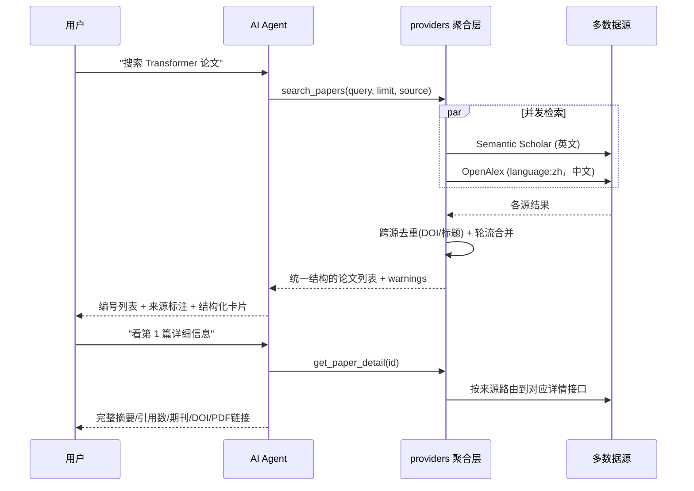

# 📚 学术文献检索助手

基于 **LangChain** + **多源学术数据源** 的智能学术文献检索对话平台。

## 功能特性

- 🤖 **科研工作流（智能体编排）**：一句话研究目标 → 自动跑完
  **检索筛选 → 信息抽取 → 综述生成 → 统计可视化 → 参考文献格式化**，
  产出带 GB/T 7714 参考文献的完整 Markdown 报告；
  每步状态实时可见，**支持中断与断点续跑**，也允许人工修正文献后再继续
- 🖼️ **图片 / PDF 识图检索**：直接粘贴截图、拖入图片或 PDF，模型读图后
  **自动去检索真实论文**。两类图都能处理：
  **论文截图 / 参考文献页** → 提出题录信息（标题/作者/DOI）再检索；
  **实验照片 / 现象图 / 图表** → 描述所见现象、归纳检索关键词再检索。
  PDF 在服务端渲染成图后读入（前 8 页）。
  **图片不落盘**：只在内存里过一遍，不写文件、不入库、不进日志
- 🔍 **实时论文搜索**：多数据源并发检索全球学术论文
- 📊 **精读文献表**：检索结果自动汇总成表格（相关度打分、全文可得性、可排序、可导出 CSV），
  并自动过滤掉查询词完全没命中的低相关度条目
- 📝 **参考文献格式化**：GB/T 7714（国标）/ APA 第 7 版 / BibTeX 三种格式一键复制与导出
- 🌏 **中英文双通道**：可切换「全部 / 英文 / 中文」，中文文献走 OpenAlex
  （`filter=language:zh`）
- 🏷️ **来源标注**：每条结果都标明来自哪个源，卡片上带来源标签
- 📄 **论文卡片**：结构化结果渲染成卡片，每篇可单独收藏、看详情、跳原文/PDF
- 📋 **详细查看**：点击「详情」直连后端取完整摘要、引用数、期刊、DOI 等
- ⏳ **进度可见**：转圈动画 + 阶段文字（正在思考／正在检索／正在生成）+ 实时已等待秒数，
  长耗时也不会让人以为卡死
- ⚡ **真流式输出**：基于 `astream_events`，答案边生成边显示，不用等整段生成完
- 💬 **对话式交互**：自然语言对话，支持多轮上下文记忆
- 🌐 **Web 界面**：Flask + SSE 流式响应
- ⌨️ **命令行模式**：支持终端交互
- 📦 **自动安装依赖**：启动时自动检测并安装缺失的 Python 包

## 数据源架构

数据源被隔离在 `providers/` 一层，工具层和前端只认识一种统一的论文结构。
**换源或加源 = 新增一个 provider 文件，不用动 `app.py` / `Agent.py` / 前端。**

### 五个数据源（全部免费，无需付费授权）

| 数据源 | 语言 | 是否需要 Key | 它补的是什么 |
|--------|------|--------------|--------------|
| **Semantic Scholar** | 英文 | 可选（强烈建议） | 覆盖广、带引用图谱；不配 key 走公共通道，高峰期必被限流 |
| **OpenAlex** | 英文 + 中文 | 不需要 | 保底源，稳定免费，中文靠 `filter=language:zh` |
| **Crossref** | 英文 + 中文 | 不需要 | **卷期页码最全** —— GB/T 7714 参考文献靠它补全 |
| **Europe PMC** | 英文 | 不需要 | 生命科学/生物医学，**带被引次数** |
| **DOAJ** | 英文 | 不需要 | 只收开放获取期刊，用来判断"能不能免费读全文" |

每个源的实测结论（这些数字是接的时候打接口量出来的，不是照抄文档）：

| 源 | 实测 | 备注 |
|----|------|------|
| Crossref | 检索 3 次/秒；按 DOI 取单条 10 次/秒 | 配额按池划分：**不带 `mailto` 掉进公开池（5 次/秒、并发 1），并发检索很容易 429**；带上就进礼貌池（并发 3）。所以 `CROSSREF_MAILTO` 建议填 |
| Crossref | 不提供可信的被引次数 | `is-referenced-by-count` 很多出版商没提交，实测常是 0，所以本项目**不拿它当影响力指标**，如实给 0 |
| Europe PMC | 一次请求拿全（摘要+作者+被引+卷期页） | 用 `resultType=core`；分页是 `cursorMark` 游标而非 offset |
| DOAJ | 一次命中即代表全文开放 | **不提供被引次数**，如实给 0；只覆盖 OA 期刊，不能当主源 |
| Semantic Scholar | 5 个源里最慢的一个（实测 8.3s） | 其余四个都在 1.5-2.3s；缓存命中后整轮 0s |

**关于 PubMed**：这次**没有接入**。原因不是它不好，而是实测发现
`esummary` 的 JSON 返回里**没有摘要字段**（只有标题/作者/卷期页/DOI），
要拿摘要必须再走 `efetch` 解析 XML。而 Europe PMC 本身就包含 PubMed 的记录，
并且一次调用就给摘要 + 被引次数。两个都接只会让同一批文献重复出现、
还得为 XML 给 `HttpClient` 加一条非 JSON 分支。**如果你要的正是 PubMed 独有的
MeSH 主题词**，告诉我，我再单独接。

### 选源规则（`providers/__init__.py` 的 `_plan_for`）

**中文查询不调用英文源**，这是实测结论：

- S2 对中文只做**字面匹配**。实测查「经济」返回的是"童亭矿…煤层**经济**开采…"（采煤）
  和"建筑工程项目管理…施工现场管理…"（施工），只因为标题里恰好有"经济"两个字，与经济学无关；
- 新增的 Europe PMC / DOAJ 同理：中文检索式丢给它们只会返回字面命中的英文论文，
  把真正相关的中文文献挤出前面（接源时实测过）；
- 但 **Crossref 保留在中文组**：中文期刊只要有 DOI 就有卷期页，
  实测查「遥感图像语义分割」时 Crossref 补出了 `62(20): 2028005` 这类完整著录字段，
  而同一个源（OpenAlex）给的是空卷期页。

| 查询语言 | 「全部」实际调用的源 |
|----------|--------------------|
| 中文（含汉字） | OpenAlex(`language:zh`) + Crossref |
| 英文 | Semantic Scholar + OpenAlex + Crossref + Europe PMC + DOAJ |

英文查询下 S2 才是强项，照旧参与。以后若拿到 S2 的 API Key，
可以去掉 `_plan_for` 里那行中文判断，但要重新验证中文相关性。

### 关于中文文献（为什么不是知网/万方）

知网**没有面向个人开发者的公开检索 API**，[知网研学开放平台](https://openx.cnki.net/)
只做机构商务合作（需邮件申请、要写明机构名称），常规访问方式是高校图书馆年度包库采购。

万方的[开放平台](https://open.wf.pub/)有可对接的 REST API，官方还发布了面向智能体的
[技能包文档](https://github.com/wanfangdata/wfdata-open-skills)（接口覆盖期刊/学位/会议/
专利/标准全文，认证方式是 `X-Ca-AppKey` + `Authorization: APPCODE`），
但**需要商务申请、商业授权**，个人/学生团队一般拿不到。

通过爬虫抓取知网违反其用户协议，且已有侵犯著作权罪与不正当竞争的判例（参见
[数据库数据来源的法律风险分析](https://www.ciplawyer.cn/articles/156975.html)）。
Google Scholar 同样没有官方 API、明确禁止自动抓取，且会按出口 IP 封禁
（影响同一网络下的正常使用），所以也没有接入。

**所以本项目当前的中文来源是 OpenAlex + Crossref**（都免费、无需 key、零合规风险），
局限要说清楚：中文核心期刊覆盖率仍不如知网/万方，不少中文文献没有摘要。
Crossref 能补上一部分卷期页，但补不了覆盖率。

代码里预留了接入位置：数据源注册表在 `providers/__init__.py` 的 `SOURCES` 与 `GROUPS`，
`split_id` 的前缀表由 `register_id_prefixes(SOURCES.keys())` 自动同步，
所以新增源只需「一个 provider 文件 + 注册表一行 + 分组一行」。

`warnings` 字段只反映**本次检索真的失败**的来源（限流/超时），
"未配置/未启用"属于部署状态，不会每轮都向用户汇报。

## 工作流程



## 科研工作流（智能体编排）

面向"写一篇综述 / 做一次文献调研"这类**整篇任务**。聊天适合问答，工作流适合跑完整条流水线。

### 四大核心功能 → 流水线步骤

| 核心功能 | 步骤 key | 做什么 |
|----------|----------|--------|
| ① 文献自动检索与筛选 | `search` | 调 `providers` 多源并发检索，按相关度过滤排序 |
| ② 文献信息抽取与综述生成 | `extract` → `synthesize` | 分批抽取研究对象/方法/数据/指标/结论，再归纳现状、分歧与空白 |
| ③ 实验数据统计与可视化 | `analyze` | 年份分布、被引分布、文献类型、全文可得性，输出文本条形图 |
| ④ 参考文献格式化 | `format` | 生成 GB/T 7714 参考文献表，整合成 Markdown 报告 |

### 智能体要素

- **自规划**：`plan_workflow()` 让模型读研究目标，产出检索式、检索范围、关注点、综述章节。
  规划失败会自动退回一份保守的默认计划，不会让整条流水线跑不起来。
- **任务拆解与递归执行**：抽取按 8 篇一批切分，综述按章节组织，失败只标记该步不拖垮全流程。
- **自规划 + 任务移交**：聊天里说"帮我写篇综述"，模型会判断这属于整篇任务，
  调 `start_research_workflow` 把活移交给工作流引擎，聊天界面出现「开始执行」按钮。
  模型只负责规划，**不臆造综述内容**。
- **确定性编排**：步骤由模型规划，但每步做什么是代码写死的。
  这是"中断后能从第 N 步续跑"的前提 —— 自由工具循环没法恢复。

### 中断与恢复（工作流状态管理）

- **中断**：面板上的「■ 中断」按 `workflow_id` 置一个标志（`_RUNNING`）。
  编排器每步开头、以及分批抽取的**每一批之前**都会查一次，所以长步骤也能及时停下。
- **语义**：已经跑完的步骤保持 `done`（成果不丢），断点落在
  "本来要开始、却被拦下"的那一步上，**全流程只有一个断点**。
- **恢复**：`POST /api/workflow` 只带 `workflow_id` 就是续跑。
  服务端从库里算出最早没跑完的那一步作为起点，`context` 里已完成的产物（文献、抽取字段、
  综述正文）直接复用，不重跑。前端面板上会出现「⏵ 从断点继续」。
- **人工修正**：续跑时可以带 `papers` 覆盖字段，用人工挑选/修正过的文献列表继续跑后面的步骤。

### 性能：为什么"感觉卡"以及怎么修的

实测一条完整流水线约 12-13 秒（真实模型 + 真实数据源）。用加了时间戳的
profiler 量过之后，时间分布是这样的：

| 环节 | 耗时 | 说明 |
|------|------|------|
| 自规划 | 1.5-1.9s | 一次模型调用（已有缓存，见下） |
| 检索筛选 | 1.6s | 多源并发，不算慢 |
| 信息抽取 | 1.8s | 8 篇为 1 批；批数多时并发跑 |
| **综述生成** | **7.1s** | 一次大 JSON 生成（5 节正文 + 共识/空白/局限），占总时长 56% |
| 统计 + 格式化 + 落库 | < 0.2s | 纯本地计算 |

修的三处（按收益排序）：

1. **改成真流式推送**（收益最大，也最容易被忽略）。
   原来路由里是同步跑完编排器、再一次性回放事件列表 —— 面板在最后 12.6s
   才拿到全部事件，前 12.6 秒界面上只有一句"工作流执行中…"，看起来就是卡死。
   现在编排器跑在独立线程里，每步状态变化立刻经 `queue.Queue` 推给客户端
   （和 `/api/chat` 同一套做法）。**首个状态更新从 12.6s 降到 0.01s**，
   用户能实时看到"规划 → 检索 → 抽取 → 综述 → 统计 → 格式化"走到哪一步。
   注意：真实总耗时没变，变的是观感。
2. **抽取批次并发**。多批之间没有任何依赖（各自输入是文献切片，输出按 id 回填），
   串行跑 3 批就是 6-7s 纯等。改成线程池并发（并发度 3），
   实测 2 批 16 篇从 0.8s 降到 0.4s。中断语义仍保持在"批次边界"：
   已发出的批次跑完并照收结果，未发出的不再发。
3. **规划结果缓存**。规划要 1.5-1.9s，而"中断后从断点续跑""重复点开始执行"
   用的目标字符串完全一样，每次都调模型纯属白等。按目标文本缓存后，
   实测第二次同目标整条流水线 12.6s → 10.3s。

**没有为了提速而牺牲质量**：综述生成那 7.1s 是模型在写 5 节正文，
是主要成本也是主要产出。把它拆成多次并发调用理论上能缩短墙钟时间，
但各段之间会失去"一份完整上下文"，还会各自复述简介 —— 那样的"快"是假快。
所以这里选择如实说明：**这一段的耗时下限由模型出字速度决定**。

面板上运行中的那一步会显示**实时已等待秒数**，配合流式推送，
用户随时知道是在跑还是在等。

### 与其他面板的关系

工作流跑出的文献会顺带灌进「📊 文献表」，两个面板共用一份数据；
报告可在面板里导出 Markdown。

### `POST /api/workflow`（SSE，需登录）

请求体三种用法：

```jsonc
{"goal": "图神经网络在遥感图像中的应用进展"}          // 新建并从头跑
{"workflow_id": 12}                                   // 从断点续跑
{"workflow_id": 12, "papers": [ ... ]}                // 人工修正文献后续跑
```

事件流：

| type | 含义 |
|------|------|
| `plan` | 规划结果 + `workflow_id`；续跑时带 `resumed: true` 和 `start_from` |
| `step` | 某一步的状态变化：`running` / `done` / `failed` / `interrupted` / `skipped` |
| `snapshot` | 全部步骤终态 + 文献 + 统计 + 综述 + 参考文献 + 报告全文 |
| `error` | 单步或整条流水线的错误 |
| `done` | 结束，`status` 为 `done` / `partial`（有步骤失败）/ `interrupted` |

配套接口（**四个工作流接口都要求登录并校验归属**）：`GET /api/workflow/<id>`（读状态，
便于刷新后恢复面板）、`POST /api/workflow/<id>/interrupt`（请求中断）、
`DELETE /api/workflow/<id>`。

> 归属校验不是可选项：工作流 id 是自增的，若 `GET` 允许"读不到就按 id 兜底再查一次"，
> 匿名用户顺着 id 就能把别人的整份报告、检索式和文献列表读走。

## 技术栈

| 层级 | 技术 |
|------|------|
| Agent 框架 | LangChain（`create_agent`） |
| 论文数据 | 多源聚合：Semantic Scholar / OpenAlex |
| 后端 | Flask 3.x + SSE 流式 |
| 前端 | 原生 HTML / CSS / JavaScript |

## 项目结构

```
AIagent1/
├── Agent.py             # 命令行版文献检索助手
├── app.py               # Web 版 Flask 服务（自动安装依赖）
├── workflow.py          # 科研工作流编排器（自规划 / 五步流水线 / 中断恢复 / 报告生成）
├── providers/           # 多源检索层（核心）
│   ├── __init__.py      #   聚合 + 跨源去重 + 详情路由（对外只暴露这里）
│   ├── base.py          #   统一论文结构 / provider 接口 / 错误类型 / 作者清洗
│   ├── http.py          #   节流 + 指数退避 + 结果缓存 的 HTTP 基座
│   ├── semantic_scholar.py  # Semantic Scholar provider（英文，引用图谱）
│   ├── openalex.py      #   OpenAlex provider（含摘要倒排索引还原）
│   ├── crossref.py      #   Crossref provider（卷期页码最全，补 GB/T 7714）
│   ├── europepmc.py     #   Europe PMC provider（生命科学，带被引次数）
│   └── doaj.py          #   DOAJ provider（开放获取期刊，判断能否读全文）
├── database.py          # SQLite：用户 / 搜索历史 / 收藏 / 会话（对话记录）/ 工作流状态
├── attachments.py       # 图片 / PDF 附件：校验、PDF 渲染成图、多模态消息拼装
├── restart.ps1          # 干净重启（先清掉残留的旧进程，避免"改了代码不生效"）
├── view.py              # 小工具：直接查看数据库里的搜索历史
├── literature.db        # SQLite 数据库文件（不要提交，见「注意事项」）
├── requirements.txt     # Python 依赖清单
├── .env.example         # 环境变量模板
├── .gitignore           # Git 忽略规则
├── DEPLOY.md            # 公网部署（natapp 内网穿透）与 502 排查
├── README.md            # 项目说明
├── tests/               # 测试（不依赖 pytest，见「快速开始 / 跑测试」）
│   ├── run_all.py       #   一把跑完所有用例
│   ├── test_workflow.py         # 编排器
│   ├── test_workflow_api.py     # 工作流 API
│   ├── test_interrupt_resume.py # 中断与断点续跑
│   ├── test_agent_handoff.py    # 对话→工作流任务移交
│   ├── test_chat_route.py       # 聊天接口（SSE / 卡片 / 移交 / 思考状态）
│   ├── test_attachments.py      # 图片与 PDF 附件（后端）
│   ├── test_exposure.py         # 公网暴露面（源码不外泄 / 口令门禁）
│   ├── test_smoke.py            # 静态白名单 / 鉴权 / 跨用户隔离
│   ├── test_migration.py        # 老库升级补新表
│   ├── check_tunnel.py          # 公网链路体检（本地服务/客户端/域名/访问）
│   ├── test_frontend_authors.js # 前端作者格式（node 跑）
│   ├── test_attachments_frontend.js # 前端附件（node 跑，含属性转义）
│   └── live_run.py      #   真机端到端（需 API Key）
└── static/              # Web 前端（白名单托管，见「注意事项」）
    ├── index.html       # 单文件前端（内联 CSS/JS：登录、会话列表、聊天、论文卡片、文献表、收藏、润色、工作流面板）
    ├── favicon-paper.svg  # 站点图标
    └── logo-paper.svg     # 项目标记（index.html 里内联了同一图形）
```

## 登录与对话记录

- **可以直接使用**：打开页面即可检索论文，不需要登录（游客对话不做任何保存，刷新即清空）。
- **登录入口在左上角**：头像徽章「👤 未登录」，点开是登录/注册浮层。
- **需要登录的功能**：左侧「对话记录」、收藏、摘要润色、科研工作流、精读文献表。
  未登录时点击会弹「登录后才能使用」的提示，点提示里的「去登录」直接展开登录框；
  登录成功后会自动打开你刚才想用的那个面板，不用再点一次。
- **对话记录**：
  - 登录后，每轮问答会自动保存到服务端（`conversations` + `conversation_messages` 两张表）。
  - 左侧列出该账号的历史会话（标题取首条消息），点哪条就加载哪条，可以接着聊。
  - 「＋ 新对话」开一段新的；列表项右侧 ✕ 删除单条；底部可清空全部。
  - 未登录时不显示列表，也不会有任何对话落库。

### 账号存在哪里（注册一次即可长期使用）

注册的账号**保存在项目目录里**，下次运行（甚至把整个项目文件夹拷到别处）都能直接登录：

| 文件 | 作用 |
| --- | --- |
| `literature.db` | SQLite 主库，`users` 表存用户名 + bcrypt 密码哈希 |
| `accounts.json` | 账号备份，每次注册后自动同步；启动时自动补进库里还没有的账号 |

- **密码不会明文保存**：两个文件里存的都是 bcrypt 哈希，登录时用哈希比对。
- **换目录/库丢了也不怕**：启动或登录时如果本地库里没有这个用户名，会自动去
  `accounts.json` 找一次；找到就补回库里，照常用原来的密码登录。
- **不用每次重新登录**：登录态是 30 天的持久 cookie（`PERMANENT_SESSION_LIFETIME`），
  关掉浏览器、重启服务都还在；注册成功会直接自动登录。
- **想手动挪账号**：把 `literature.db` / `accounts.json` 和项目一起拷过去即可。
  `accounts.json` **已进版本库**（只有 bcrypt 哈希、体积很小，意义就是让账号跟着项目走），
  `git clone` 就带得过去；`literature.db` 在 `.gitignore` 里（二进制、含收藏/对话等全部业务数据），
  要连历史一起搬就手动拷它。
- 默认都放在 `database.py` 旁边（也就是项目根目录）；`accounts.json` 的位置可以用
  环境变量 `PAPER_ACCOUNTS_FILE` 覆盖。启动时控制台会打印实际路径
  （`🗄 账号数据库` / `🧾 账号备份`）。

## 右侧弹窗（收藏 / 科研工作流 / 文献表 / 润色）

四个功能都开在右侧的浮层卡片里，都不挤占对话区：

- **拖动**：按住标题栏拖到任意位置。
- **改大小**：拖面板右下角（`⌟` 手柄）自由缩放，最小 260×200，最大不超过视口；
  面板比屏幕高时由面板内部滚动，不会出现"够不到"的情况。
- **复原**：双击标题栏回到右侧默认位置和默认大小。
- 位置和大小在本次页面打开期间一直保留（关掉再打开还在原处、还是那个大小）；
  刷新页面回到默认。
- **Esc**：先收弹窗，再收登录浮层。

## 快速开始

### 1. 配置（只需填自己的 API Key）

**API Key 不随仓库分发**，需要你自己写一次。在项目根目录建一个
`.env.local`（已在 `.gitignore` 里，不会被提交），内容只需一行：

```ini
DEEPSEEK_API_KEY=sk-你的密钥
```

密钥申请：<https://platform.deepseek.com/api_keys>

也可以改用系统环境变量 `DEEPSEEK_API_KEY`（优先级高于文件）。

没填就直接启动时，会看到一段能照着做的提示，而不是一堆报错：
它会直接告诉你"在哪个文件的哪一行写什么"。

**两层的分工**（加载顺序 `.env` → `.env.local`，后者覆盖前者）：

| 文件 | 是否进库 | 放什么 |
|------|----------|--------|
| `.env` | 进（团队共用） | 模型名、超时、`FLASK_SECRET_KEY` 等**不含个人 API Key** 的配置 |
| `.env.local` | 不进（每人自己写） | **你的** `DEEPSEEK_API_KEY`，以及你想临时改的任何项 |

`FLASK_SECRET_KEY` 之所以留在共用文件里：它不是计费凭据（泄露后果是"能伪造登录"，
而非"被刷钱"）；而且团队共用同一个值，登录态在各自环境间才一致，
不会因为谁重新生成一次就把所有人踢下线。公网部署时建议换成自己的值。

`.env.example` 是**配置文档**：列出全部可选项及含义，供查阅。

加载逻辑统一在 `envconfig.py`，网页版 / 命令行版 / 真机脚本共用同一套 ——
避免"换个目录启动就读不到配置"这类坑各修各的（`Agent.py` 原先就踩过）。

这条设计有专门的用例守着（`tests/test_env_config.py`，17 项），
因为它一旦被破坏就是密钥泄露。

> ⚠️ 提交前确认 `.env` 里的 `DEEPSEEK_API_KEY` 仍然是空的。
> 如果你曾把真实 Key 写进过 `.env` 并提交，**删掉也不够** ——
> 它会留在 git 历史里，必须轮换密钥。

### 2. 启动

```bash
python app.py
```

首次运行会自动安装缺失的依赖，然后浏览器访问 `http://127.0.0.1:8000`。
启动日志会打印账号数据库/账号备份的实际路径，方便确认"账号存在哪"。

### 3. 命令行模式

```bash
python Agent.py
```

### 4. 跑测试

```bash
python tests/run_all.py
```

**故意不依赖 pytest**，只用标准库 —— 每个用例都是独立脚本，
跑完打印 `N/M checks passed` 并以退出码表示成败，
在没装任何测试框架的机器上（比如评委的环境）也能直接验证。

| 用例文件 | 覆盖内容 | 检查数 |
|----------|----------|--------|
| `test_workflow.py` | 规划回退与缓存、分批抽取的全局序号换算、统计、综述、GB/T 7714、全流程、中断、续跑、跳过、单步失败隔离 | 63 |
| `test_workflow_api.py` | SSE 事件流、落库、断点续跑、人工修正文献、鉴权、限流降级 | 50 |
| `test_interrupt_resume.py` | 两种中断时机（步骤内部 / 步骤之间）、断点唯一性、跨会话续跑 | 28 |
| `test_agent_handoff.py` | 对话 → 工作流的任务移交工具（返回形状、落库、规划失败不炸对话） | 19 |
| `test_chat_route.py` | 聊天接口：SSE 帧、token 流、论文卡片、任务移交事件、**回答非空**、结构化数据不冒充正文 | 27 |
| `test_new_sources.py` | Crossref/Europe PMC/DOAJ 字段归一化 + 相关度词首规则（喂真实报文形状，含异形字段） | 79 |
| `test_streaming.py` | 工作流流式推送（首个事件不能等到最后）+ 抽取批次并发 + 中断边界 | 12 |
| `test_smoke.py` | 静态文件白名单（源码不外泄）、未登录鉴权、**跨用户按 id 猜也读不到别人的工作流** | 37 |
| `test_migration.py` | 老库升级：`init_db()` 给已存在的库补新表且不动原有数据 | 4 |
| `test_frontend_authors.js` | 前端参考文献作者格式与后端规则一致（从 index.html 里抽真函数来跑） | 11 |
| `test_pagination.js` | 搜索结果折叠 + 翻页、工作流"已等待秒数"接线 | 40 |

三个**真机**脚本（需要先按「快速开始 / 配置」把 `DEEPSEEK_API_KEY` 写进 `.env.local`，
会真实调用模型和数据源）：

```bash
python tests/live_run.py     # 工作流全流程，约 13 秒，报告写到 tests/live_report.md
python tests/live_chat.py    # 聊天接口（含"农业""自动化"这类查询）
python tests/live_stream.py  # 对着**运行中的服务**量 SSE 到达时间线（验证真的在流式推送）
```

`test_chat_route.py` 用一个假 agent 喂脚本化的事件，**不打网络也不花 token**，
但完整走一遍 `/api/chat` 的解析与 SSE 输出 —— 这个文件是因为一次真实事故补的：
`DEEPSEEK_MODEL` 未定义导致 `/api/chat` 每次请求都抛 `NameError`，
界面表现是"本轮没有收到回复内容，请重试"，而当时所有工作流用例都是绿的。

同理 `test_streaming.py` 用 mock 模型证明"代码是边跑边推"，
`live_stream.py` 再用真实链路确认没有被缓冲或攒包 —— 两层都验才算数。

所有测试都在 `tests/_tmp_*.db` 上操作，**不会碰 `literature.db`**。

## 工具说明

| 工具 | 功能 | 参数 |
|------|------|------|
| `search_papers` | 多源并发检索论文 | `query`: 关键词（中英文均可）<br>`limit`: 返回数量(1-10)<br>`source`: `all`全部 / `cn`仅中文 / `en`仅英文 |
| `get_paper_detail` | 获取论文详情 | `paper_id`: 检索结果里的 `id` 字段，或论文标题 |
| `start_research_workflow` | 把整篇任务移交给科研工作流引擎 | `goal`: 一句话研究目标 |

`source` 由前端的「文献来源」开关（全部/英文/中文）通过系统消息传入，模型会用它调用工具。

`start_research_workflow` 每次请求现造（`_make_research_tool`），因为它要把"已规划好哪条工作流"
回传给**本次请求**的 SSE 流。用闭包捕获回调，避免用模块级变量导致两个用户同时聊天时互相覆盖。

## API 说明

### `POST /api/chat`

SSE 流式聊天接口。

**请求体：**

```json
{
  "message": "搜索 transformer 论文",
  "history": [
    { "role": "user", "content": "你好" },
    { "role": "assistant", "content": "你好！有什么可以帮你的？" }
  ],
  "conversation_id": null,
  "source_pref": "all",
  "files": [
    { "name": "shot.png", "mime": "image/png", "data": "<base64，不带 data URL 前缀>" }
  ]
}
```

`conversation_id` 为 null 表示开一段新对话（登录用户会新建会话）；传入已有 id 则续写该会话。
`source_pref` 取值 `all` / `en` / `cn`，决定本轮检索的文献来源范围。

`files` 为**可选**字段，用于图片 / PDF 附件（见「识图检索」）：
* `data` 是 base64，允许带 `data:image/png;base64,` 前缀；服务端按魔术字节判断真实类型，不信任 `mime`
* 最多 5 个文件、单个 ≤ 12 MB、合计 ≤ 24 MB；PDF 只取前 8 页并渲染成 PNG
* 非法附件返回 `400`，`error` 字段是可读的中文原因（点名是哪个文件、支持哪些格式）
* **不带 `files` 时请求体与以前完全一致**，纯文本路径行为不变
* `message` 与 `files` 至少要有其一（只发图不写字是允许的）

**响应：** `Content-Type: text/event-stream`

| 事件 type | 含义 | 示例 |
|-----------|------|------|
| `conversation_id` | 本轮写入的会话 id（仅登录用户） | `{"type":"conversation_id","conversation_id":3}` |
| `status` | 当前阶段提示（前端显示转圈 + 阶段文字 + 已等待秒数） | `{"type":"status","text":"正在检索文献源…"}` |
| `papers` | 结构化论文列表（前端渲染成卡片） | `{"type":"papers","papers":[{...}]}` |
| `token` | 增量文本（真流式，边生成边下发） | `{"type":"token","token":"以下是"}` |
| `workflow_ready` | 模型判断这是整篇任务，已规划好科研工作流（前端渲染方案卡 + 「开始执行」按钮） | `{"type":"workflow_ready","workflow_id":12,"goal":"…","plan":{…}}` |
| `done` | 流结束 | `{"type":"done"}` |
| `error` | 错误 | `{"type":"error","message":"..."}` |

典型事件顺序：

```
status[正在思考…] → status[正在检索文献源…] → papers → status[正在阅读检索结果并生成回答…] → token… → done
```

`papers` 事件是论文卡片、来源标签、每篇独立收藏按钮的数据来源
（直接从工具返回的 JSON 里提取，不再让前端用正则从 Markdown 里猜标题）。

**两套链接必须分清**（卡片里也分开显示，顺序按"先能浏览、再要全文"排）：

| 字段 | 含义 | 卡片上显示为 |
|------|------|--------------|
| `url` | 网页地址（来源页 / DOI 页），点开是普通网页、能直接浏览 | `阅读` + 「网页」标签，排第一 |
| `openAccessPdf` | 完整论文的 PDF 直链 | `全文` + 「PDF」或「可能直接下载」标签 |

实测：OJS 类期刊的 `/article/download/...` 端点带 `Content-Disposition: attachment`，
点开会**强制下载文件**而不是在浏览器里打开；DOI 页则都是 HTML。
所以「阅读」排在前面，PDF 标注是否可能触发下载，避免用户莫名其妙下一堆文件。

`isOa` / `oaStatus`（gold/diamond/bronze/closed）来自数据源，用于在缺少 PDF 直链时
给出准确提示：开放获取的网页里可能就能读全文，非开放获取的通常只有摘要。
OpenAlex 的 `best_oa_location.pdf_url` 命中率不错（实测中文 OA 期刊 9/10 有直链），
但**付费论文不存在免费全文链接**，这一点不能靠代码变出来。

**关于流式**：`/api/chat` 用 `AGENT.astream_events` 实现真流式。
由于 `astream_events` 是 async 而 Flask 生成器是同步的，agent 跑在独立线程里，
事件经 `queue.Queue` 交给生成器转成 SSE。工具调用前模型常会先说一句
"我先搜索一下"（有时还是英文），那不是答案，所以 `on_tool_start` 时会丢弃这段前言。
整体带 240 秒超时，避免请求永久挂住。

### `GET /api/sources`

返回各数据源的可用状态（名称、语言、是否可用），前端据此显示当前中文来源。

### `GET /api/paper/<paper_id>`

按论文 id 取详情。单独开这个接口是为了让前端点「详情」时不必再走一轮大模型调用。

### `GET /api/paper/<paper_id>/pdf`

把论文的开放获取 PDF 转发下来，**并用可读的文件名保存**
（`年份_第一作者_标题.pdf`，例如 `2022_张辉_乡村振兴战略下农村经济发展路径.pdf`）。

为什么要中转一层：那些期刊的直链文件名是 OJS 生成的编号
（`48962-Article Text-60922-1-10-20241217.pdf`、`1609-1936-1-PB.pdf`），
存到本地根本认不出是哪篇；而浏览器会**忽略跨域链接上的 HTML `download` 属性**
（安全限制，改不了），只有从同源下载才能设置文件名。

安全上刻意收紧：**只使用我们自己数据源里记录的 `openAccessPdf`**，
不接受调用方传入的任何 URL —— 否则这个端点就成了可以抓任意地址的代理。
另外会校验响应类型必须是 PDF，非 PDF（比如落地页 HTML）直接返回 415 并提示改用「阅读」。

### `GET /api/health`

健康检查接口。返回 `{"status": "ok"}`。

### 对话记录接口（均需登录，未登录返回 401）

| 方法 | 路径 | 说明 |
|------|------|------|
| `GET` | `/api/conversations` | 会话列表（含消息条数，按最近更新倒序，空会话不返回） |
| `POST` | `/api/conversations` | 新建会话，body: `{"title": "..."}` |
| `GET` | `/api/conversations/<id>` | 读取某会话的全部消息 |
| `DELETE` | `/api/conversations/<id>` | 删除某会话及其消息 |
| `DELETE` | `/api/conversations` | 清空当前用户的全部会话 |

所有会话读写都会校验归属，无法访问其他用户的会话。

## 环境变量

| 变量名 | 必填 | 说明 |
|--------|------|------|
| `DEEPSEEK_API_KEY` | **是（自己填）** | DeepSeek API 密钥。**不随仓库分发**，写在 `.env.local` 或系统环境变量里 |
| `DEEPSEEK_MODEL` | 否 | 对话与工作流共用的模型，当前为 `deepseek-flash`，见下方「模型说明」 |
| `SEMANTIC_SCHOLAR_API_KEY` | **强烈建议** | 论文检索密钥，见下方「关于限流」 |
| `S2_MIN_INTERVAL` | 否 | S2 两次检索请求最小间隔秒数，默认 1.2 |
| `S2_MAX_RETRIES` | 否 | S2 单次请求最多尝试次数，默认 4 |
| `S2_BACKOFF_CAP` | 否 | S2 退避等待上限秒数，默认 20 |
| `S2_CACHE_TTL` | 否 | S2 检索结果缓存秒数，默认 1800 |
| `S2_BULK_FALLBACK` | 否 | S2 被限流时是否用 bulk 端点兜底，默认 1 |
| `OPENALEX_MAILTO` | 否 | 邮箱，填入后进 OpenAlex「礼貌池」，稳定性更好 |
| `OPENALEX_MIN_INTERVAL` | 否 | OpenAlex 请求最小间隔秒数，默认 0.2 |
| `OPENALEX_CACHE_TTL` | 否 | OpenAlex 缓存秒数，默认 1800 |
| `HTTPS_PROXY` | 否 | 代理地址（国内网络不佳时使用） |
| `API_TIMEOUT` | 否 | API 超时秒数，默认 30 |
| `FLASK_SECRET_KEY` | 是 | Flask session 密钥；缺了会拒绝启动。在共用的 `.env` 里，**生成一次后不要改** |

配置来源三层，后面的覆盖前面的：**`.env` → `.env.local` → 系统环境变量**。
`.env` 进库（团队共用、**不含 API Key**），`.env.local` 不进库（每人自己写 Key 与个人覆盖），
各变量含义详见 `.env.example`。

> ⚠️ 提交前确认 `.env` 里的 `DEEPSEEK_API_KEY` 仍为空。
> 若曾把真实 Key 提交过，需立即到 DeepSeek 控制台轮换；
> 仅从文件里删除无效，密钥会留在 git 历史里。

## 关于检索限流（429）

如果遇到「检索接口正在限流」「429 Too Many Requests」，原因和解决办法如下：

**原因**：Semantic Scholar 不配 API Key 时，所有匿名调用者**共用同一把公共 key**（1000 QPS）。
你能分到多少完全取决于别人用了多少，高峰期 `/paper/search` 几乎必然被限流。
而且被限流时不一定返回 429，也可能返回 500，所以只针对 429 做重试是不够的。

**最有效的解决办法**：申请一个 API Key 填进 `SEMANTIC_SCHOLAR_API_KEY`。
它不是"提高上限"，而是把你从**拥挤的公共池**挪到**独立的稳定配额**（默认 1 请求/秒）。
申请地址：<https://www.semanticscholar.org/product/api#api-key-form>（免费）

**代码里已经做的缓解措施**（见 `providers/http.py` 与 `providers/semantic_scholar.py`）：

| 措施 | 说明 |
|------|------|
| 全局节流 | 每个源的出站请求各自串行排队，间隔不低于该源的 `*_MIN_INTERVAL` |
| 指数退避 | 2s → 4s → 8s…上限 20s；有 `Retry-After` 时优先听它的 |
| 5xx 当限流处理 | 高峰期 500 也是限流信号，和 429 一起退避重试 |
| 结果缓存 | 相同检索 30 分钟内直接命中本地缓存，不再打接口 |
| bulk 兜底 | `/paper/search` 被限流时改用 `/paper/search/bulk`（两者限流额度独立） |
| 独立端点 | 按标题查论文改用 `/paper/search/match`；按 ID 查详情走 `/paper/{id}`（几乎不限流） |
| 可选 API Key | 配置后自动带上 `x-api-key`，切到独立配额 |
| **多源兜底** | S2 被限流时，OpenAlex 仍会返回结果，整轮检索不会空手而归 |

CLI 版 `Agent.py` 与 Web 版共用同一套 `providers/`，避免两边行为不一致。

## 相关度打分：为什么是"词覆盖 + 2-gram"两层

精读文献表用 `relevance`（0-100）决定顺序和剔除，规则要能逐词解释
（"为什么这篇 62 分"要答得上来），所以不用语义相似度。

单层 2-gram 覆盖率在多词中文查询下会失灵。实测查
`图神经网络 遥感图像 语义分割`（18 条结果的真实分布）：

| 命中情况 | 例子 | 2-gram 分 |
|----------|------|-----------|
| 只命中"图像" | 《基于特征对齐…可见光-红外装甲车辆检测方法》 | 15 |
| 只命中"图像" | 《箭载图像测量技术在航天中的发展与应用》 | 10 |
| 整词命中"遥感图像"+"语义分割" | 《多层次分支跨尺度融合的遥感图像语义分割网络》 | 70 |

`图像`、`网络` 这类通用二字组合哪个标题里都有，跑题文献靠它们就能拿到 10-15 分，
而默认阈值是"分数 > 0"，于是全都留下了（18 篇里 9 篇与主题无关，
综述模型自己也如实写了"没有一篇明确以图神经网络为核心方法"）。

现在改成两层：

1. **词覆盖（主排序键）**：把检索式按空格切成整词，整词命中标题 1 分、
   标题内部分命中 0.5 分、仅摘要命中 0.2 分，加权求和。
   排序先比这个词分，`遥感图像+语义分割`（2.0）自然压过
   `图神经网络` 的部分命中（0.9）。
2. **2-gram 覆盖率（次排序键）**：同档位内再分先后，保持原有可解释性。

过滤也分两档，且**必须在同一段里依次尝试**（早先写成"第一档命中就 return"，
第二档永远走不到）：先剔 2-gram 全不命中的，再剔多词查询下一个整词都不命中的。
每档都保留"全被剔除就退回上一档"的兜底，宁可多给也不让用户空手。

效果：同一个查询从 18 篇收到 8 篇，跑题文献清零，前三名全部对题。

## 使用示例

```
用户：帮我找几篇关于 large language model 的论文

AI：已为你找到以下论文：
1. **Language Models are Few-Shot Learners**
   Brown et al., 2020 · 引用: 25000+
   摘要: GPT-3 展示了大规模语言模型在少样本学习中的强大能力...
   【来源：Semantic Scholar】

2. **数字经济赋能乡村振兴的内在逻辑及实现路径**
   王艳, 2024 · 《国际经济学刊》
   摘要: ...
   【来源：OpenAlex】

（下方同时渲染出结构化论文卡片：来源标签、收藏、详情、原文/免费PDF 按钮）

用户：我想看第一篇的详细信息

AI：[展示论文完整摘要、发表期刊、引用数、参考文献数量、PDF 链接等]
```

界面右下角的「文献来源」开关可切换 **全部 / 英文 / 中文**，
切换后本轮检索会按选定范围调用数据源（例如选"中文"时只取中文文献）。

---

## 识图检索（图片 / PDF 附件）

在对话框里可以**粘贴截图（Ctrl+V）**、**拖入文件**，或点 📎 选择文件。
模型读图后自动去检索真实论文，分两种情形（写在系统提示词里）：

| 图片类型 | 模型做什么 |
|----------|-----------|
| 论文截图、参考文献列表 | 读出题录信息（标题/作者/期刊/DOI），**调用两次检索**：一次「标题+作者+关键词」，一次 DOI 原样 |
| 实验照片、现象图、图表 | 先客观描述所见（对象、条件、趋势），再归纳 3-5 个检索关键词去检索相关研究 |

只发图不写字也能用——系统提示词里明确要求它自行判断属于哪种情形。

### 实测效果（真机，非打桩）

| 输入 | 结果 |
|------|------|
| 论文截图（生成的中文样张） | 读出《遥感图像语义分割》/ 张伟、李娜 / 测绘学报 2024 / DOI，并**指出该 DOI 前缀 `10.1234` 是留给示例的**、判断这是样张而非真实论文 |
| 番茄叶片病斑照片 | 判读出「同心轮纹状病斑 + 黄晕，疑似早疫病 *Alternaria solani*」，检索到 37 篇，英文里含 *Detecting Alternaria solani in Tomatoes* 等对口文献 |
| PDF（2 页） | 服务端渲染成图后读出标题/作者/摘要，并分别用「标题+关键词」和 DOI 检索 |

### 硬性限制（都是实测出来的，不是猜的）

- **接口只收图片**：`webp / png / jpeg / gif`。传 PDF 会被明确拒绝：
  `unsupported file ... one of the following formats: webp, png, jpeg, and gif`。
  所以 PDF 由服务端用 **PyMuPDF 渲染成 PNG**（默认 300 DPI、最多前 8 页），
  不需要额外安装 poppler 之类的系统组件。
- **单文件上限 12 MB**。实测 **14.7 MB 的图送进去不报错、但返回空内容**
  （静默失败），8.2 MB 时已经开始认不准字。所以这是可用性问题，不只是成本问题。
- **默认渲染 300 DPI**，看似浪费其实是必须的。同一问题实测：
  `DPI 100 → 成功 1/3`、`150 → 1/3`、`300 → 3/3`。
  原因不是"越清晰越好"，而是**图越难认、模型思考越久**，
  而思考内容（`reasoning_content`）和正文共用同一个 `max_tokens` 预算 ——
  认不清时它把额度全花在推理上，正文就空了，看起来像"模型没回答"。
  同理，带图的请求会把 `max_tokens` 抬高到 4000。
- **图片不落盘**：前端读成 base64 → 后端内存里解码/渲染 → 拼进消息 → 发完即丢。
  不写临时文件、不入库、日志里也没有 base64。用例会实测"处理前后目录快照一致"。

### 代码位置

- `attachments.py`：校验（按魔术字节判断真实类型，不信任前端声明的 mime）、
  PDF 渲染、多模态内容块拼装。纯逻辑，好测。
- `app.py` 的 `/api/chat`：接收 `files` 字段，构造多模态消息。
  没有附件时**不带 `files` 字段**，纯文本路径的行为与以前完全一致。
- 前端：`pickFiles / addFiles / renderAttachBar / clearAttachments`，
  以及拖拽（`.chat-main` 上的 drop zone）和粘贴监听。

## 模型说明

模型名读 `.env` 的 `DEEPSEEK_MODEL`，**不需要改代码**。
`app.py`（对话）与 `workflow.py`（科研工作流）都读同一个变量，
所以两边永远用同一个模型 —— 早先两处各写死一个默认值，
只改一处就会"聊天用一个模型、工作流用另一个"，很难排查。

### 当前设置：`deepseek-flash`（DeepSeek-V4.1-Flash）

`GET https://api.deepseek.com/models` 实测该 key 只返回两个正式模型：
`deepseek-flash` 与 `deepseek-v4-pro`。本项目用 **`deepseek-flash`**。

**代价要说清楚**：`deepseek-flash` **默认开思考**，先产出一大段
`reasoning_content` 才开始写正文。同一个问题实测对比：

| 模型 | 首个正文字符 | 总耗时 | 推理内容 |
|------|--------------|--------|----------|
| `deepseek-chat`（旧别名，非思考） | **0.6s** | **11.3s** | 0 |
| `deepseek-flash` | 21.4s | 27.4s | 4637 字 |

对话链路整体更长（含工具调用，实测首字 45.5s），因为思考发生在**两处**：
决定调不调工具之前一次、汇总答案之前再一次。

**所以代码里补了一件事**：思考模型的推理内容之前被完全丢弃，
前端在那 20-45 秒里只看到一个空白泡泡 —— 看起来就是卡死。
现在 `app.py` 会识别 `additional_kwargs.reasoning_content` 并推一条
`模型正在思考…` 状态给前端，正文一开始再切回 `正在生成回答…`。
推理内容本身**不会**混进正文（它可以很长，且不是给用户看的答案）。

想换回快而不思考的档位，改 `.env` 一行即可：

```
DEEPSEEK_MODEL=deepseek-chat
```

### 关于「R1」和 `deepseek-reasoner`（旧说法已过时）

早期文档写的是「`deepseek-reasoner`（R1）不支持 Tool Calling，所以固定用
`deepseek-chat`」。**这句话现在两半都不成立了**（对官方接口实测）：

1. **R1 已不再是一个独立模型**。`/models` 只返回
   `deepseek-flash`（DeepSeek-V4.1-Flash）与 `deepseek-v4-pro`（DeepSeek-V4-Pro-0813）。
   旧名只是"仍被接受"，请求由 V4.1-Flash 承接并按 Flash 价格计费。
2. **旧别名现在支持 Tool Calling 了**。实测 `deepseek-reasoner` 调用工具正常。

| 模型名 | 实测由谁承接 | 工具调用 | 是否产生推理内容 |
|--------|--------------|----------|------------------|
| `deepseek-flash`（当前使用） | V4.1-Flash | 是 | 是（默认开思考） |
| `deepseek-chat`（旧别名） | V4.1-Flash | 是 | 否（非思考模式，因此更快） |
| `deepseek-reasoner`（旧 R1 别名） | V4.1-Flash | 是 | 是 |
| `deepseek-v4-pro` | V4-Pro-0813 | 是 | 是 |

### 关于图标

页眉用的是**折角文稿 + 正文横线 + 右下放大镜**（折角/横线 = 论文，放大镜 = 检索）。
早先还做过一版"镜片里放三个节点连成的三角网络"（表示多源聚合），
但抽象程度太高、第一眼看不出和论文有关，已弃用并删除文件。

- `favicon-paper.svg`（32×32）供浏览器标签页；页眉里的标记是**内联 SVG**
  （前端单文件，不用 ``），与 `logo-paper.svg` 是同一图形的两份拷贝，
  **改一处要同步另一处**。
- 两版都是纯色、纯描边、无渐变无位图，16px 下也看得清。
- **新增静态资源必须加进 `app.py` 的 `STATIC_FILES` 白名单**，否则会被 404。

## 注意事项

- `deepseek-reasoner`（R1）不支持 Tool Calling，本项目固定使用 `deepseek-chat`
- **静态文件是白名单托管的，不要改回整目录托管。**
  早期写的是 `Flask(__name__, static_folder="static", static_url_path="")`，
  这会把整个 `static/` 挂到根路径通配路由上 —— 放什么就能下载什么。
  当时 `static/` 里混进了一份旧的服务端副本，实测 `GET /app.py` 能直接拿到
  200 + 21715 字节源码。现在只服务 `STATIC_FILES` 白名单里的文件，其余一律 404。
- **数据库路径用 `__file__` 锚定，不要改回相对路径。**
  原来 `DB_PATH = "literature.db"` 是相对**当前工作目录**解析的，
  从别的目录启动就会在那儿新建一个空库，现象是"收藏和历史都没了"
  （实测已经在上一层目录留下过一个 0 行的库）。现在无论从哪启动都指向
  `database.py` 旁边那一个库。
- **`literature.db` 已在 `.gitignore` 里且不再被跟踪。** 它是二进制 SQLite 文件，
  但仓库里那份历史提交被 git 当文本处理、转成了 UTF-16，打开会报
  `file is not a database` 且无法完整还原。从旧提交里取这个文件拿不到可用数据，
  用工作区里的那份。
- Web 模式启动时关闭了 `use_reloader`，避免双进程导致 SSE 流式异常。
  **代价是改完 `app.py` 必须手动重启服务**（刷新浏览器只会更新前端静态文件）
- **重启服务一定要先清干净旧进程，用 `restart.ps1`。**
  关闭 `use_reloader` 之后，如果只是"再启动一次"而没有先杀掉旧的，
  旧进程会**继续占着端口**并抢先响应请求 —— 新代码明明启动了，
  行为却完全是旧的。这个坑本项目踩过两次，而且两次都很难看出来：
  一次是新加的识图功能完全不生效（旧进程跑的是没有该功能的版本，
  模型于是回答"我没收到图片"），另一次是 `/api/chat` 全部返回空。
  `restart.ps1` 会先清进程、确认端口释放、再启动并验证，
  最后打印"监听该端口的进程数"（应该是 1，大于 1 就说明又有残留）。
- 前端每轮回答都新建独立气泡元素并直接持有引用，
  不要改回 `document.getElementById('assistant-bubble')` ——
  每条助手消息都会带同一个 id 且不移除，从第二轮起会命中旧气泡，
  导致答案写进上一条消息、新气泡停在加载动画上（看起来像卡死）
- 数据源注册表在 `providers/__init__.py` 的 `SOURCES` / `GROUPS`。
  新增数据源时注意：能被 `available()` 关掉的源如果没配置，
  **不要**把它塞进 `warnings`（那是部署状态，不是本轮故障），
  否则每轮回答都会多一段"某某源未启用"的噪音

---

## 总结

AIagent 是一个轻量、完整的 **LangChain + DeepSeek Agent** 示例：涵盖工具定义、Agent 创建、
流式输出、多轮对话，以及 CLI 与 Web 两种交互形态。数据源抽象成了可插拔的
`providers/` 层（多源并发、跨源去重、统一论文结构、按来源路由详情查询），
换数据源不用改业务代码，适合作为学习 Agent 开发或二次扩展的基础模板。
