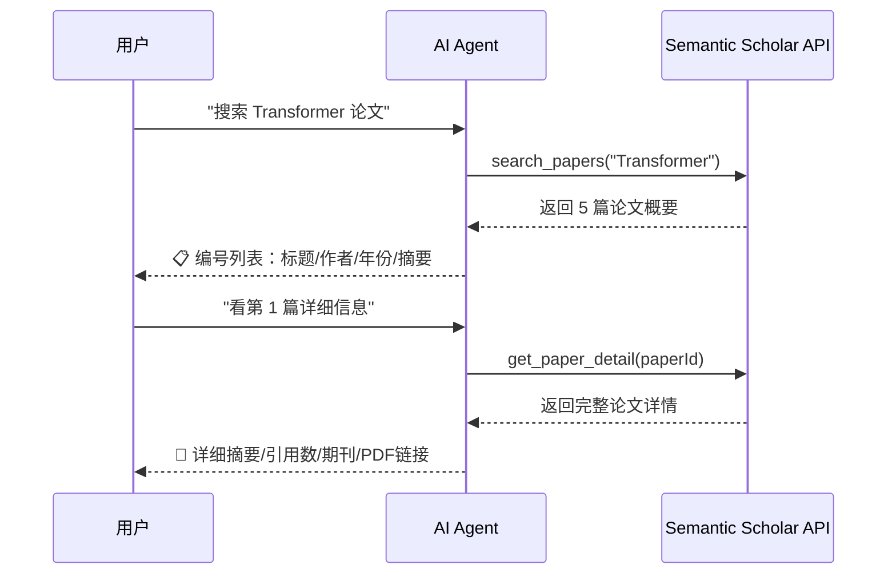

# 📚 学术文献检索助手

基于 **LangChain** + **Semantic Scholar API** 的智能学术文献检索对话平台。

## 功能特性

- 🔍 **实时论文搜索**：通过 Semantic Scholar API 实时检索全球学术论文
- 📄 **论文概览**：AI 自动整理搜索结果，以简洁列表呈现标题、作者、年份、摘要
- 📋 **详细查看**：用户指定某篇论文后，获取完整摘要、引用数、发表期刊、开放获取链接等
- 💬 **对话式交互**：自然语言对话，支持多轮上下文记忆
- 🌐 **Web 界面**：Flask + SSE 流式响应，实时显示检索结果
- ⌨️ **命令行模式**：支持终端交互
- 📦 **自动安装依赖**：启动时自动检测并安装缺失的 Python 包

## 工作流程



## 技术栈

| 层级 | 技术 |
|------|------|
| Agent 框架 | LangChain（`create_agent`） |
| 论文数据 | Semantic Scholar API（免费，无需 API Key） |
| 后端 | Flask 3.x + SSE 流式 |
| 前端 | 原生 HTML / CSS / JavaScript |

## 项目结构

```
AIagent/
├── Agent.py             # 命令行版文献检索助手
├── app.py               # Web 版 Flask 服务（自动安装依赖）
├── s2_client.py         # Semantic Scholar 访问层：节流/退避/缓存/API Key（CLI 与 Web 共用）
├── database.py          # SQLite：用户 / 搜索历史 / 收藏 / 会话（对话记录）
├── view.py              # 小工具：直接查看数据库里的搜索历史
├── literature.db        # SQLite 数据库文件
├── requirements.txt     # Python 依赖清单
├── .env.example         # 环境变量模板
├── .gitignore           # Git 忽略规则
├── README.md            # 项目说明
└── static/              # Web 前端
    └── index.html       # 单文件前端（内联 CSS/JS：登录、会话列表、聊天、收藏、润色）
```

## 登录与对话记录

- **可以直接使用**：打开页面即可检索论文，不需要登录（游客对话不做任何保存，刷新即清空）。
- **登录入口在左上角**：头像徽章「👤 未登录」，点开是登录/注册浮层。
- **需要登录的功能**：左侧「对话记录」、收藏、摘要润色。未登录时点击会弹窗提示并引导登录。
- **对话记录**：
  - 登录后，每轮问答会自动保存到服务端（`conversations` + `conversation_messages` 两张表）。
  - 左侧列出该账号的历史会话（标题取首条消息），点哪条就加载哪条，可以接着聊。
  - 「＋ 新对话」开一段新的；列表项右侧 ✕ 删除单条；底部可清空全部。
  - 未登录时不显示列表，也不会有任何对话落库。

## 快速开始

### 1. 配置

复制 `.env.example` 为 `.env`，填入 API Key：

```bash
cp .env.example .env
```

### 2. 启动

```bash
python app.py
```

首次运行会自动安装缺失的依赖，然后浏览器访问 `http://127.0.0.1:8000`。

### 3. 命令行模式

```bash
python Agent.py
```

## 工具说明

| 工具 | 功能 | 参数 |
|------|------|------|
| `search_papers` | 搜索学术论文 | `query`: 关键词，`limit`: 返回数量(1-10) |
| `get_paper_detail` | 获取论文详细信息 | `paper_id`: 论文ID 或标题 |

## API 说明

### `POST /api/chat`

SSE 流式聊天接口。

**请求体：**

```json
{
  "message": "搜索 transformer 论文",
  "history": [
    { "role": "user", "content": "你好" },
    { "role": "assistant", "content": "你好！有什么可以帮你的？" }
  ],
  "conversation_id": null
}
```

`conversation_id` 为 null 表示开一段新对话（登录用户会新建会话）；传入已有 id 则续写该会话。

**响应：** `Content-Type: text/event-stream`

| 事件 type | 含义 | 示例 |
|-----------|------|------|
| `conversation_id` | 本轮写入的会话 id（仅登录用户） | `{"type":"conversation_id","conversation_id":3}` |
| `token` | 增量文本 | `{"type":"token","token":"以下是"}` |
| `done` | 流结束 | `{"type":"done"}` |
| `error` | 错误 | `{"type":"error","message":"..."}` |

### `GET /api/health`

健康检查接口。返回 `{"status": "ok"}`。

### 对话记录接口（均需登录，未登录返回 401）

| 方法 | 路径 | 说明 |
|------|------|------|
| `GET` | `/api/conversations` | 会话列表（含消息条数，按最近更新倒序，空会话不返回） |
| `POST` | `/api/conversations` | 新建会话，body: `{"title": "..."}` |
| `GET` | `/api/conversations/<id>` | 读取某会话的全部消息 |
| `DELETE` | `/api/conversations/<id>` | 删除某会话及其消息 |
| `DELETE` | `/api/conversations` | 清空当前用户的全部会话 |

所有会话读写都会校验归属，无法访问其他用户的会话。

## 环境变量

| 变量名 | 必填 | 说明 |
|--------|------|------|
| `DEEPSEEK_API_KEY` | 是 | DeepSeek API 密钥 |
| `SEMANTIC_SCHOLAR_API_KEY` | **强烈建议** | 论文检索接口密钥，见下方「关于限流」 |
| `S2_MIN_INTERVAL` | 否 | 两次检索请求最小间隔秒数，默认 1.2 |
| `S2_MAX_RETRIES` | 否 | 单次请求最多尝试次数，默认 4 |
| `S2_BACKOFF_CAP` | 否 | 退避等待上限秒数，默认 20 |
| `S2_CACHE_TTL` | 否 | 检索结果缓存秒数，默认 1800 |
| `S2_BULK_FALLBACK` | 否 | 被限流时是否用 bulk 端点兜底，默认 1 |
| `HTTPS_PROXY` | 否 | 代理地址（国内网络不佳时使用） |
| `API_TIMEOUT` | 否 | API 超时秒数，默认 30 |

参考 `.env.example` 进行配置。**切勿将真实 API Key 提交到版本库。**

## 关于检索限流（429）

如果遇到「检索接口正在限流」「429 Too Many Requests」，原因和解决办法如下：

**原因**：Semantic Scholar 不配 API Key 时，所有匿名调用者**共用同一把公共 key**（1000 QPS）。
你能分到多少完全取决于别人用了多少，高峰期 `/paper/search` 几乎必然被限流。
而且被限流时不一定返回 429，也可能返回 500，所以只针对 429 做重试是不够的。

**最有效的解决办法**：申请一个 API Key 填进 `SEMANTIC_SCHOLAR_API_KEY`。
它不是"提高上限"，而是把你从**拥挤的公共池**挪到**独立的稳定配额**（默认 1 请求/秒）。
申请地址：<https://www.semanticscholar.org/product/api#api-key-form>（免费）

**代码里已经做的缓解措施**（见 `s2_client.py`）：

| 措施 | 说明 |
|------|------|
| 全局节流 | 所有出站请求串行排队，间隔不低于 `S2_MIN_INTERVAL`（默认 1.2s） |
| 指数退避 | 2s → 4s → 8s…上限 20s；有 `Retry-After` 时优先听它的 |
| 5xx 当限流处理 | 高峰期 500 也是限流信号，和 429 一起退避重试 |
| 结果缓存 | 相同检索 30 分钟内直接命中本地缓存，不再打接口 |
| bulk 兜底 | `/paper/search` 被限流时改用 `/paper/search/bulk`（两者限流额度独立） |
| 独立端点 | 按标题查论文改用 `/paper/search/match`；按 ID 查详情走 `/paper/{id}`（几乎不限流） |
| 可选 API Key | 配置后自动带上 `x-api-key`，切到独立配额 |

CLI 版 `Agent.py` 与 Web 版共用同一个 `s2_client.py`，避免两边行为不一致。

## 使用示例

```
用户：帮我找几篇关于 large language model 的论文

AI：已为你找到以下论文：
1. **Language Models are Few-Shot Learners**
   Brown et al., 2020 · 引用: 25000+
   摘要: GPT-3 展示了大规模语言模型在少样本学习中的强大能力...

2. **Training Language Models to Follow Instructions**
   Ouyang et al., 2022 · 引用: 8000+
   摘要: InstructGPT 通过人类反馈强化学习使模型更好地遵循指令...

用户：我想看第一篇的详细信息

AI：[展示论文完整摘要、发表期刊、引用数、参考文献数量、PDF 链接等]
```

---

## 注意事项

- `deepseek-reasoner`（R1）不支持 Tool Calling，本项目固定使用 `deepseek-chat`
- Web 模式启动时关闭了 `use_reloader`，避免双进程导致 SSE 流式异常
- CLI 与 Web 的 System Prompt 略有不同（双关语预报员 vs 通用助手），工具逻辑一致

---

## 总结

AIagent 是一个轻量、完整的 **LangChain + DeepSeek Agent** 入门示例：涵盖工具定义、Agent 创建、流式输出、多轮对话，以及 CLI 与 Web 两种交互形态。代码结构清晰，工具层预留了替换真实 API 的接口，适合作为学习 Agent 开发或二次扩展的基础模板。
