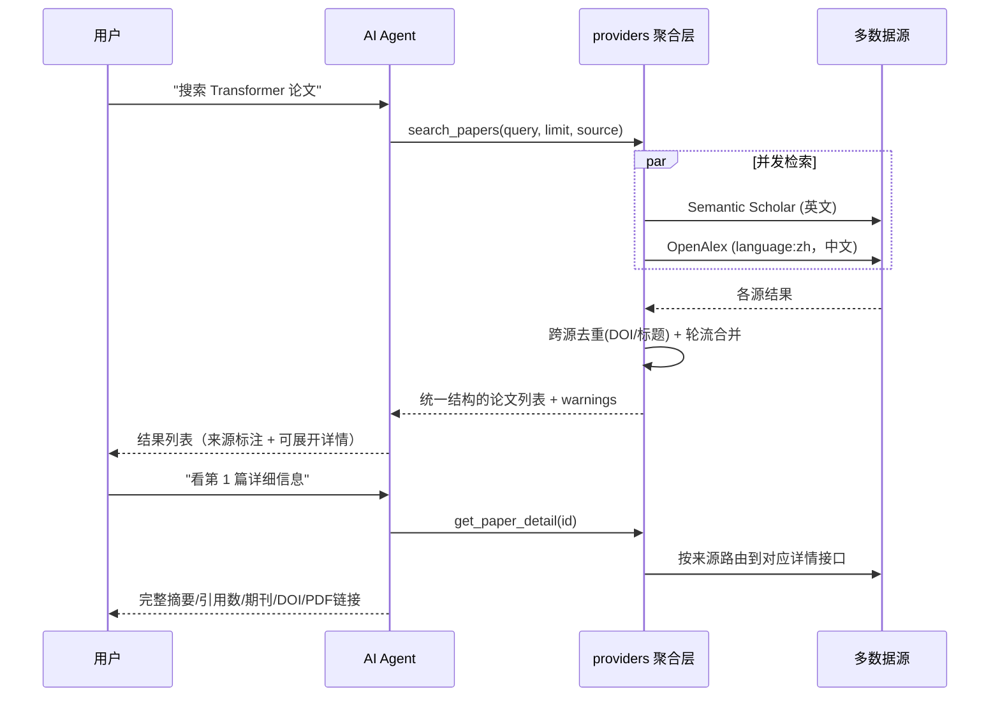

# 📚 学术文献检索助手

基于 **多源学术数据源** + **大模型查询理解** 的学术文献检索平台。

界面是**搜索框 + 结果列表**（类似搜索引擎），不是对话框：
输入关键词或一句自然语言，结果以列表堆叠在下方，点任意一条展开详细信息。

## 功能特性

- 🔍 **实时论文搜索**：多数据源并发检索全球学术论文
- 🤖 **智能体检索**：不是一次性"翻译关键词"，而是**规划 → 检索 → 自评 → 不够就换策略重搜 → 归纳导读**
  的完整循环；每一步都显示在界面上（阶段、状态、耗时），智能体的动作不是黑盒
- 🧠 **智能体导读**：读懂检索到的那几篇，给出 2-4 句导读、最多 3 条要点、
  最多 3 个**可继续检索的方向**（点一下就直接搜），以及这批结果的局限说明。
  硬性约束：只能依据给定结果，不许引入列表之外的论文或数字
- 📝 **查询理解**：把「帮我找几篇图神经网络的综述」解析成检索关键词与来源范围。
  模型**只负责理解与归纳**，结果列表里的标题/作者/年份/被引/链接全部来自数据源结构化数据，
  所以不存在编造论文的可能
- 📋 **点击展开详情**：列表每行可展开，显示完整摘要、一句话摘要、作者、
  期刊卷期页码、被引、DOI、学科，以及「阅读原文 / 下载全文 PDF / 收藏 / 润色」按钮
- 📝 **参考文献格式化**：GB/T 7714（国标）/ APA 第 7 版 / BibTeX 三种格式，
  单条复制或一键复制全部
- ⬇️ **导出 CSV**：把当前结果导出成表格（带 BOM，Excel 打开中文不乱码）
- 📈 **结果排序**：高被引、新近的文献排前面（打分公式见下），
  并给每篇标出排序分（悬停可看构成：被引分 ×0.65 + 年份分 ×0.35）
- 📄 **分页浏览**：每页 20 篇，底部「上一页 / 下一页」翻页。
  翻页只重新检索、**不再重跑智能体的规划与归纳**（内容没变），所以比首次搜索快得多；
  各页在服务端有缓存，来回翻几乎零成本
- 🌏 **中英文双通道**：可切换「全部 / 英文 / 中文」；中文文献走 OpenAlex
  （`filter=language:zh`）
- 🏷️ **来源与开放获取标注**：每条标明来源（Semantic Scholar / OpenAlex），
  开放获取且有全文直链的额外打标
- ⭐ **收藏**：登录后每条可收藏，右侧抽屉统一查看与移除
- ✍️ **摘要润色**：把某条论文的摘要一键送进润色面板，或自己粘贴（需登录）
- ⏳ **进度可见**：转圈动画 + 阶段文字（正在理解检索意图／正在检索文献源）
  + 实时已等待秒数，长耗时也不会让人以为卡死
- 🌐 **Web 界面**：Flask + SSE 流式响应（边解析边推进阶段）
- ⌨️ **命令行模式**：支持终端交互
- 📦 **自动安装依赖**：启动时自动检测并安装缺失的 Python 包

> 关于「真流式」：这一版**没有**对话回答正文，所以不存在逐字输出。
> SSE 只用来推送阶段状态、解析出的检索词、结构化结果和错误，
> 这些都在**解析完成后立刻下发**，不会等整段生成完。

## 数据源架构

数据源被隔离在 `providers/` 一层，工具层和前端只认识一种统一的论文结构。
**换源或加源 = 新增一个 provider 文件，不用动 `app.py` / `Agent.py` / 前端。**

| 数据源 | 语言 | 是否需要 Key | 说明 |
|--------|------|--------------|------|
| **Semantic Scholar** | 英文 | 可选（强烈建议） | 不配 key 也能用，但走公共通道，高峰期必被限流 |
| **OpenAlex** | 英文 + 中文 | 不需要 | 完全免费，中文靠 `filter=language:zh` 过滤，默认启用 |

### 选源规则（`providers/__init__.py` 的 `_plan_for`）

**中文查询不调用 Semantic Scholar**，这是实测结论：

- S2 对中文只做**字面匹配**。实测查「经济」返回的是"童亭矿…煤层**经济**开采…"（采煤）
  和"建筑工程项目管理…施工现场管理…"（施工），只因为标题里恰好有"经济"两个字，与经济学无关；
- S2 公共配额经常 429，本来就时好时坏；
- 实测同一个中文查询，OpenAlex 加不加 `language:zh` 过滤结果一致，
  所以去掉 S2 **不损失任何中文覆盖**。

| 查询语言 | 「全部」实际调用的源 |
|----------|--------------------|
| 中文（含汉字） | 仅 OpenAlex（此时等价于「中文」） |
| 英文 | Semantic Scholar + OpenAlex |

英文查询下 S2 才是强项，照旧参与。以后若拿到 S2 的 API Key，
可以去掉 `_plan_for` 里那行中文判断，但要重新验证中文相关性。

### 关于中文文献（为什么不是知网/万方）

知网**没有面向个人开发者的公开检索 API**，[知网研学开放平台](https://openx.cnki.net/)
只做机构商务合作（需邮件申请、要写明机构名称），常规访问方式是高校图书馆年度包库采购。
万方的[开放平台](https://open.wf.pub/)确实有可对接的 REST API，但同样需要商务申请 appKey。

个人/学生团队拿不到这两家的授权，而通过爬虫抓取知网违反其用户协议、
且已有侵犯著作权罪与不正当竞争的判例（参见
[数据库数据来源的法律风险分析](https://www.ciplawyer.cn/articles/156975.html)）。

**所以本项目当前的中文来源只有 OpenAlex**（免费、无需 key、零合规风险），
局限要说清楚：中文核心期刊覆盖率不如知网/万方，不少中文文献没有摘要或 DOI。

代码里预留了接入位置：数据源注册表在 `providers/__init__.py` 的 `SOURCES` 与 `GROUPS`。
如果以后拿到有授权的中文源（例如万方 appKey），新增一个 provider 文件、
在注册表加一行、把 `GROUPS["cn"]` 里排到前面即可，业务代码不用改。

`warnings` 字段只反映**本次检索真的失败**的来源（限流/超时），
"未配置/未启用"属于部署状态，不会每轮都向用户汇报。

## 工作流程



## 技术栈

| 层级 | 技术 |
|------|------|
| Agent 框架 | LangChain（`create_agent`） |
| 论文数据 | 多源聚合：Semantic Scholar / OpenAlex |
| 后端 | Flask 3.x + SSE 流式 |
| 前端 | 原生 HTML / CSS / JavaScript |

## 项目结构

```
AIagent1/
├── Agent.py             # 命令行版文献检索助手
├── app.py               # Web 版 Flask 服务（自动安装依赖）
├── providers/           # 多源检索层（核心）
│   ├── __init__.py      #   聚合 + 跨源去重 + 详情路由（对外只暴露这里）
│   ├── base.py          #   统一论文结构 / provider 接口 / 错误类型
│   ├── http.py          #   节流 + 指数退避 + 结果缓存 的 HTTP 基座
│   ├── semantic_scholar.py  # Semantic Scholar provider
│   └── openalex.py      #   OpenAlex provider（含摘要倒排索引还原）
├── s2_client.py         # 向后兼容层：转发到 providers.semantic_scholar
├── database.py          # SQLite：用户 / 搜索历史 / 收藏（会话表已不再使用）
├── view.py              # 小工具：直接查看数据库里的搜索历史
├── literature.db        # SQLite 数据库文件（不要提交，见「注意事项」）
├── requirements.txt     # Python 依赖清单
├── .env.example         # 环境变量模板
├── .gitignore           # Git 忽略规则
├── README.md            # 项目说明
└── static/              # Web 前端
    └── index.html       # 单文件前端（内联 CSS/JS：搜索框、结果列表、展开详情、收藏、润色）
```

## 登录说明

- **可以直接检索**：打开页面就能搜，不需要登录，也不会保存任何搜索记录。
- **登录入口在右上角**：徽章「👤 未登录」，点开是登录/注册浮层。
- **需要登录的功能**：收藏、摘要润色。未登录时点击会弹窗提示并引导登录。
- **收藏**：登录后展开任意结果的详情可点「☆ 收藏」，右上角「⭐ 收藏」打开抽屉查看/移除/清空。
- 收藏数据存在服务端（`favorites` 表），与账号绑定。

> 这一版**没有对话记录功能**了。早期的 `conversations` /
> `conversation_messages` 两张表还在数据库里，但代码已经不再读写
> （会话列表随对话框界面一起去掉了）；表里的历史数据未被删除。

## 快速开始

### 1. 配置

复制 `.env.example` 为 `.env`，填入 API Key：

```bash
cp .env.example .env
```

### 2. 启动

```bash
python app.py
```

首次运行会自动安装缺失的依赖，然后浏览器访问 `http://127.0.0.1:8000`。

### 3. 命令行模式

```bash
python Agent.py
```

## 检索层与工具

Web 版（`app.py`）**不再使用 Agent 工具循环**：`/api/search` 只调用一次模型做查询理解，
然后直接调用 `providers.search_papers()`。

CLI 版（`Agent.py`）仍然是 LangChain Agent，定义了这两个工具：

| 工具 | 功能 | 参数 |
|------|------|------|
| `search_papers` | 多源并发检索论文 | `query`: 关键词（中英文均可）<br>`limit`: 返回数量(1-10)<br>`source`: `all`全部 / `cn`仅中文 / `en`仅英文 |
| `get_paper_detail` | 获取论文详情 | `paper_id`: 检索结果里的 `id` 字段，或论文标题 |

两边共用同一个 `providers/` 层，所以检索、去重、限流行为完全一致。

## API 说明

### `POST /api/search`

检索接口 —— 一个受控的**智能体循环**。

#### 四步循环

| 步骤 | 做什么 | 失败时会怎样 |
|------|--------|--------------|
| 1. 规划 | 理解需求，产出检索词 / 范围 / 策略说明 | 退化成"把输入原样当关键词" |
| 2. 检索 | 直连 `providers` 多源并发检索 | 报 error 事件，搜索框仍可用 |
| 3. 观察 + 重规划 | **自评结果够不够好**；不够就用不同角度重搜一轮（最多 1 次） | 重搜没更好就沿用第一轮 |
| 4. 归纳 | 读懂结果给出导读、要点、后续方向 | 只是少一块导读，列表照常返回 |

**为什么不让模型自由调工具**：检索路径保持确定可控（最多 2 轮、每轮都有降级），
模型只在"规划 / 评估后的重规划 / 归纳"这三处发挥判断力。
这样既有智能体的"观察-反思-再行动"，又不会出现不可预期的耗时和费用。

**"够不够好"是本地规则判断的**（不再多调一次模型，省一次往返）：
数量是否偏少（阈值跟着 `limit` 走）、靠前标题里有没有核心词（跑题检测）、
平均相关度是否过低、是不是只有一个源在供给。
第 4 条单独出现不算失败 —— 中文检索本来就只有 OpenAlex。

实测效果（查「帮我找几篇图神经网络的综述」）：

```
✓ [规划] 用户要综述，优先找 review 类文献
✓ [检索] 取回 5 条
! [评估] 结果不够理想：靠前结果的标题里没有「图神经网络」，很可能跑题
▶ [调整] 原词过窄，退回核心概念「图神经网络」
✓ [检索] 取回 5 条    ✓ [评估] 覆盖正常
✓ [归纳] 已生成导读
```

#### 请求体

```json
{ "message": "帮我找几篇图神经网络的综述", "source_pref": "all", "per_page": 20, "offset": 0 }
```

| 参数 | 说明 |
|------|------|
| `message` | 用户输入。**翻页时传"上一页最终生效的检索词"**（因为智能体可能改过词） |
| `source_pref` | `all` / `en` / `cn`，留空则采用模型判断。**用户手动选了就以他为准** |
| `per_page` | 每页条数，1-50，默认 20 |
| `offset` | 跳过前多少条，翻页用，`(页码-1) × per_page` |
| `synthesis` | 传 `false` 跳过归纳那一步（翻页时前端就传 false，省一次模型调用） |

**翻页行为**：`offset > 0` 时视为翻页 —— 不再重跑"规划"和"归纳"，直接按
用户上次看到的检索词取下一页。所以翻页只有 1 次检索，明显更快。

**为什么翻页要传"最终生效的检索词"**：智能体可能把「图神经网络 综述」
自我纠正成「图神经网络」。如果翻页时还传原始输入，会重新规划一遍、
拿到与第 1 页不同批次的排序，页码就错位了。

#### 结果排序：相关度优先，同档内按「被引 + 年份」

排序键是 **(相关度, 排序分)** 的降序二元组：

```
1) 相关度 降序      —— 门槛
2) 排序分 降序      —— 同相关度内的次序
排序分 = 0.65 × 被引分 + 0.35 × 年份分
```

**为什么相关度仍然是第一关键字**：如果只看被引和年份，一篇高被引但跑题的论文
会被推到最前（实测英文查 `graph neural network` 时会捞到一篇 2008 年、被引 9710
的无关论文），用户反而更难用。相关度是"能不能用"，影响力是"值不值得先看"。

**被引分**用 log 压缩（`log1p(n)/log1p(10000)`）：

| 被引 | 0 | 10 | 100 | 1k | 10k | 100k |
|------|---|----|-----|----|-----|------|
| 得分 | 0.00 | 0.26 | 0.50 | 0.75 | 1.00 | 1.00 |

被引分布是重尾的，用原始值归一化的话一篇十万被引会把其它全压成 0 分，
整个列表由它一个人决定；log 之后既保留量级差异，又不会吃掉整个列表。

**年份分**按半衰期衰减（`0.5 ** (age/6)`）：

| 年数 | 今年 | 3 年 | 6 年 | 12 年 | 20 年 |
|------|------|------|------|-------|-------|
| 得分 | 1.00 | 0.71 | 0.50 | 0.25 | 0.10 |

用半衰期而不是线性：线性到 20 年就把老论文判 0 分，但学术价值不会在某年突然归零。
年份缺失或非数字一律给 0（不猜）。

**为什么是 0.65 / 0.35**：被引是学术影响力的直接证据，权重给多一些；
但年份占三分之一强，这样 **0 被引的新论文**（中文库里非常多）仍能排到
同相关度、同样 0 被引的老论文前面。

三个常量都在 `providers/__init__.py` 顶部，可以直接调：
`CITATIONS_WEIGHT` / `RECENCY_WEIGHT` / `RECENCY_HALF_LIFE`。

排序发生在**打分之后、切片之前**：所以第 N 页是"全局排序后的第 N 段"，
各页之间不会重复或错位。（一开始把排序写在了打分之前，那时 relevance 还是 0，
排序等于没生效 —— 实测输出是「相关度 75 / 100 / 75 / 100」交错的，一眼能看出来。）

#### 响应事件：`Content-Type: text/event-stream`

| 事件 type | 含义 |
|-----------|------|
| `agent_step` | 智能体的一步动作：`{phase, text, status}`。`phase` ∈ plan/search/observe/replan/synthesize，`status` ∈ run/done/warn |
| `query` | 采用的检索参数；换词重搜后会**再发一次**并带 `revised: true` |
| `papers` | 结构化结果（前端渲染成列表，展开取详情） |
| `synthesis` | 导读：`{summary, highlights[], followups[], caveat}` |
| `warn` | 某个数据源本轮失败（限流/超时） |
| `result` | 统计：`{total, page, per_page, offset, has_more, is_last_page, sources, filtered_out, query}` |
| `error` | 错误（含 `retryable` / `suggestion`） |
| `done` | 结束 |

`total` 是**本页返回的条数**，不是数据源报告的总命中数 —— 后者需要额外一次请求，
对翻页按钮来说不值当。`has_more` 表示本页取满（即可能还有下一页）。

典型顺序：

```
agent_step[plan,run] → agent_step[plan,done] → query
  → agent_step[search,run] → agent_step[search,done]
  → agent_step[observe,done|warn] → [agent_step[replan] → agent_step[search] → query(revised)]
  → papers → agent_step[synthesize,run] → agent_step[synthesize,done] → synthesis
  → result → done
```

**归纳环节的硬性约束**（写进提示词里）：只能依据给出的文献，不得引入列表之外的
论文/作者/年份/引用数，结果不匹配就如实说明而不是硬凑。
实测它会主动讲"这批文献与需求匹配度很低，没有一篇是综述"——
这种时候它给的是**真实判断**，不是安慰话。

#### 「全部」会按检索词语言收窄

`providers` 的 `"all"` 计划是「英文源一路 + OpenAlex 中文过滤一路」。
检索词是英文时那路中文检索纯属噪音 —— 实测查 `graph neural network` 时
`language:zh` 返回的是《光学神经网络及其应用》《基于BP神经网络的股票价格预测研究》，
只因标题含"神经网络"。所以英文词走 `en`、中文词走 `cn`；
用户手动选的 `en`/`cn` 不受影响。

#### 两套链接必须分清（详情区里也分开显示）

| 字段 | 含义 | 界面上显示为 |
|------|------|--------------|
| `url` | 网页地址（来源页 / DOI 页），点开是普通网页、能直接浏览 | `阅读（来源页/DOI 页）` |
| `openAccessPdf` | 完整论文的 PDF 直链 | `下载全文 PDF`（同源代理，见下） |

实测：OJS 类期刊的 `/article/download/...` 端点带 `Content-Disposition: attachment`，
点开会**强制下载文件**；DOI 页则都是 HTML。所以两个链接分开给，不混为一谈。

**付费论文不存在免费全文链接**，这一点不能靠代码变出来。

### `GET /api/sources`

返回各数据源的可用状态（名称、语言、是否可用），前端据此显示当前中文来源。

### `GET /api/paper/<paper_id>`

按论文 id 取详情。单独开这个接口是为了让前端点「详情」时不必再走一轮大模型调用。

### `GET /api/paper/<paper_id>/pdf`

把论文的开放获取 PDF 转发下来，**并用可读的文件名保存**
（`年份_第一作者_标题.pdf`，例如 `2022_张辉_乡村振兴战略下农村经济发展路径.pdf`）。

为什么要中转一层：那些期刊的直链文件名是 OJS 生成的编号
（`48962-Article Text-60922-1-10-20241217.pdf`、`1609-1936-1-PB.pdf`），
存到本地根本认不出是哪篇；而浏览器会**忽略跨域链接上的 HTML `download` 属性**
（安全限制，改不了），只有从同源下载才能设置文件名。

安全上刻意收紧：**只使用我们自己数据源里记录的 `openAccessPdf`**，
不接受调用方传入的任何 URL —— 否则这个端点就成了可以抓任意地址的代理。
另外会校验响应类型必须是 PDF，非 PDF（比如落地页 HTML）直接返回 415 并提示改用「阅读」。

### `GET /api/health`

健康检查接口。返回 `{"status": "ok"}`。

### 搜索历史接口（保留，但前端已不再调用）

| 方法 | 路径 | 说明 |
|------|------|------|
| `GET` | `/api/history` | 该用户的搜索历史（最近 20 条） |
| `DELETE` | `/api/history` | 清空搜索历史 |

这两个接口在当前界面里**没有入口**（会话/历史列表随对话框界面一起删掉了），
保留只是为了以后要做"搜索历史"时不用重写。注意 `/api/search` 现在
**不再写入** `search_history` 表，所以这个接口读到的会是旧数据。

> 已删除的接口：`/api/chat`、`/api/conversations`（全部方法）。
> 前端已无任何调用；`conversations` / `conversation_messages` 两张表也
> 不再被读写，历史数据留在库里未删。

## 环境变量

| 变量名 | 必填 | 说明 |
|--------|------|------|
| `DEEPSEEK_API_KEY` | 是 | DeepSeek API 密钥 |
| `DEEPSEEK_MODEL` | 否 | 查询理解用的模型，默认 `deepseek-chat`，见下方「模型说明」 |
| `SEMANTIC_SCHOLAR_API_KEY` | **强烈建议** | 论文检索密钥，见下方「关于限流」 |
| `S2_MIN_INTERVAL` | 否 | S2 两次检索请求最小间隔秒数，默认 1.2 |
| `S2_MAX_RETRIES` | 否 | S2 单次请求最多尝试次数，默认 4 |
| `S2_BACKOFF_CAP` | 否 | S2 退避等待上限秒数，默认 20 |
| `S2_CACHE_TTL` | 否 | S2 检索结果缓存秒数，默认 1800 |
| `S2_BULK_FALLBACK` | 否 | S2 被限流时是否用 bulk 端点兜底，默认 1 |
| `OPENALEX_MAILTO` | 否 | 邮箱，填入后进 OpenAlex「礼貌池」，稳定性更好 |
| `OPENALEX_MIN_INTERVAL` | 否 | OpenAlex 请求最小间隔秒数，默认 0.2 |
| `OPENALEX_CACHE_TTL` | 否 | OpenAlex 缓存秒数，默认 1800 |
| `HTTPS_PROXY` | 否 | 代理地址（国内网络不佳时使用） |
| `API_TIMEOUT` | 否 | API 超时秒数，默认 30 |
| `FLASK_SECRET_KEY` | 否 | Flask session 密钥，公网部署务必设置随机值 |

参考 `.env.example` 进行配置。**切勿将真实 API Key 提交到版本库。**

## 关于检索限流（429）

如果遇到「检索接口正在限流」「429 Too Many Requests」，原因和解决办法如下：

**原因**：Semantic Scholar 不配 API Key 时，所有匿名调用者**共用同一把公共 key**（1000 QPS）。
你能分到多少完全取决于别人用了多少，高峰期 `/paper/search` 几乎必然被限流。
而且被限流时不一定返回 429，也可能返回 500，所以只针对 429 做重试是不够的。

**最有效的解决办法**：申请一个 API Key 填进 `SEMANTIC_SCHOLAR_API_KEY`。
它不是"提高上限"，而是把你从**拥挤的公共池**挪到**独立的稳定配额**（默认 1 请求/秒）。
申请地址：<https://www.semanticscholar.org/product/api#api-key-form>（免费）

**代码里已经做的缓解措施**（见 `providers/http.py` 与 `providers/semantic_scholar.py`）：

| 措施 | 说明 |
|------|------|
| 全局节流 | 每个源的出站请求各自串行排队，间隔不低于该源的 `*_MIN_INTERVAL` |
| 指数退避 | 2s → 4s → 8s…上限 20s；有 `Retry-After` 时优先听它的 |
| 5xx 当限流处理 | 高峰期 500 也是限流信号，和 429 一起退避重试 |
| 结果缓存 | 相同检索 30 分钟内直接命中本地缓存，不再打接口 |
| bulk 兜底 | `/paper/search` 被限流时改用 `/paper/search/bulk`（两者限流额度独立） |
| 独立端点 | 按标题查论文改用 `/paper/search/match`；按 ID 查详情走 `/paper/{id}`（几乎不限流） |
| 可选 API Key | 配置后自动带上 `x-api-key`，切到独立配额 |
| **多源兜底** | S2 被限流时，OpenAlex 仍会返回结果，整轮检索不会空手而归 |

CLI 版 `Agent.py` 与 Web 版共用同一套 `providers/`，避免两边行为不一致。

## 使用示例

```
用户：帮我找几篇关于 large language model 的论文

AI：已为你找到以下论文：
1. **Language Models are Few-Shot Learners**
   Brown et al., 2020 · 引用: 25000+
   摘要: GPT-3 展示了大规模语言模型在少样本学习中的强大能力...
   【来源：Semantic Scholar】

2. **数字经济赋能乡村振兴的内在逻辑及实现路径**
   王艳, 2024 · 《国际经济学刊》
   摘要: ...
   【来源：OpenAlex】

（界面同时把它渲染成结果列表：来源标签、相关度、可展开详情、收藏、原文/免费PDF 链接）

用户：我想看第一篇的详细信息

AI：[展示论文完整摘要、发表期刊、引用数、参考文献数量、PDF 链接等]
```

界面右下角的「文献来源」开关可切换 **全部 / 英文 / 中文**，
切换后本轮检索会按选定范围调用数据源（例如选"中文"时只取中文文献）。

---

## 模型说明

模型名读 `.env` 的 `DEEPSEEK_MODEL`，默认 `deepseek-chat`，**不需要改代码**。

### ⚠️ 关于「R1」和 `deepseek-reasoner`（已过时的说法）

早期版本的 README 写着「`deepseek-reasoner`（R1）不支持 Tool Calling，所以固定用
`deepseek-chat`」。**这句话现在两半都不成立了**（2026-09 对官方接口实测）：

1. **R1 已不再是一个独立模型**。`GET https://api.deepseek.com/models` 只返回两个：
   `deepseek-flash`（DeepSeek-V4.1-Flash）与 `deepseek-v4-pro`（DeepSeek-V4-Pro-0813）。
   旧名只是"仍被接受"，请求由 V4.1-Flash 承接并按 Flash 价格计费。
2. **旧别名现在支持 Tool Calling 了**。实测 `deepseek-reasoner` 调用工具正常。

| 模型名 | 实测由谁承接 | 工具调用 | 是否产生推理内容 |
|--------|--------------|----------|------------------|
| `deepseek-chat`（默认） | V4.1-Flash | ✅ | ❌ 不产生（非思考模式） |
| `deepseek-reasoner`（旧 R1 别名） | V4.1-Flash | ✅ | ✅ |
| `deepseek-flash`（正式名） | V4.1-Flash | ✅ | ✅ 默认开思考 |
| `deepseek-v4-pro` | V4-Pro-0813 | ✅ | ✅ |

### 为什么默认还是 `deepseek-chat`

不是因为"reasoner 不能调工具"，而是因为这个别名**恰好走非思考模式**。
V4.1-Flash 默认开思考并返回 `reasoning_content`，而本项目的流式代码
（`app.py` 里 `on_chat_model_stream` 那段）只读 `chunk.content`、不处理推理内容——
于是思考期间前端**一个字都收不到**，观感上比现在的"边生成边显示"更像卡住；
而且推理 token 按输出计费，对"检索论文 + 整理列表"这类任务是纯浪费。

**要用思考模式**（`deepseek-flash` / `deepseek-v4-pro`），建议顺带把
`reasoning_content` 也通过 SSE 推给前端做个「思考过程」折叠区，
否则思考阶段会是空窗期。

---

## 注意事项

- **静态文件是白名单托管的，不要改回整目录托管。**
  早期写的是 `Flask(__name__, static_folder="static", static_url_path="")`，
  这会把整个 `static/` 挂到根路径通配路由上 —— 放什么就能下载什么。
  当时 `static/` 里混进了一份旧的服务端副本，实测 `GET /app.py` 能直接拿到
  200 + 21715 字节源码。现在只服务 `STATIC_FILES` 白名单里的
  `index.html`（前端是单文件、内联 CSS/JS），其余一律 404。
  以后往 `static/` 放新资源，记得同时加进白名单。
- **数据库路径用 `__file__` 锚定，不要改回相对路径。**
  原来 `DB_PATH = "literature.db"` 是相对**当前工作目录**解析的，
  从别的目录启动就会在那儿新建一个空库，现象是"收藏和历史都没了"
  （实测已经在 `AIagent2\` 下留过一个 0 行的库）。现在无论从哪启动都指向
  `database.py` 旁边那一个库。
- **`literature.db` 已在 `.gitignore` 里且不再被跟踪。** 它是二进制 SQLite 文件，
  但仓库里那份历史提交被 git 当文本处理、转成了 UTF-16，打开会报
  `file is not a database` 且无法完整还原。它同时装着 bcrypt 密码哈希和收藏数据，
  本来也不该进版本库。**从旧提交里取这个文件是拿不到可用数据的，用工作区里的那份。**
- Web 模式启动时关闭了 `use_reloader`，避免双进程导致 SSE 流式异常。
  **代价是改完 `app.py` 必须手动重启服务**（刷新浏览器只会更新前端静态文件）
- 前端每轮回答都新建独立气泡元素并直接持有引用，
  不要改回 `document.getElementById('assistant-bubble')` ——
  每条助手消息都会带同一个 id 且不移除，从第二轮起会命中旧气泡，
  导致答案写进上一条消息、新气泡停在加载动画上（看起来像卡死）
- 数据源注册表在 `providers/__init__.py` 的 `SOURCES` / `GROUPS`。
  新增数据源时注意：能被 `available()` 关掉的源如果没配置，
  **不要**把它塞进 `warnings`（那是部署状态，不是本轮故障），
  否则每轮回答都会多一段"某某源未启用"的噪音

---

## 总结

AIagent 是一个轻量、完整的 **LangChain + DeepSeek Agent** 示例：涵盖工具定义、Agent 创建、
搜索式 Web 界面、SSE 阶段推送，以及 CLI 与 Web 两种交互形态。数据源抽象成了可插拔的
`providers/` 层（多源并发、跨源去重、统一论文结构、按来源路由详情查询），
换数据源不用改业务代码，适合作为学习 Agent 开发或二次扩展的基础模板。
