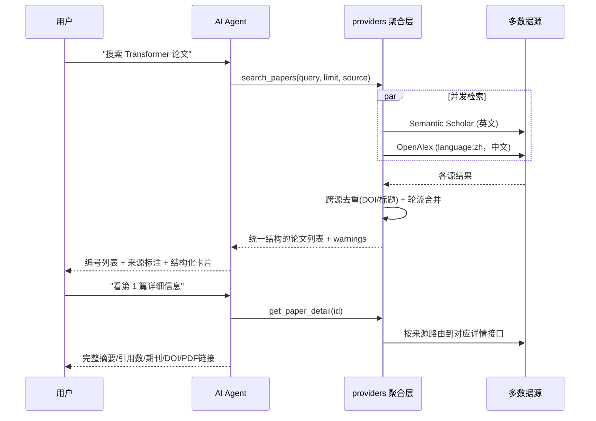

# 📚 学术文献检索助手

基于 **LangChain** + **多源学术数据源** 的智能学术文献检索对话平台。

## 功能特性

- 🔍 **实时论文搜索**：多数据源并发检索全球学术论文
- 📊 **精读文献表**：检索结果自动汇总成表格（相关度打分、全文可得性、可排序、可导出 CSV），
  并自动过滤掉查询词完全没命中的低相关度条目
- 📝 **参考文献格式化**：GB/T 7714（国标）/ APA 第 7 版 / BibTeX 三种格式一键复制与导出
- 🌏 **中英文双通道**：可切换「全部 / 英文 / 中文」，中文文献走 OpenAlex
  （`filter=language:zh`）
- 🏷️ **来源标注**：每条结果都标明来自哪个源，卡片上带来源标签
- 📄 **论文卡片**：结构化结果渲染成卡片，每篇可单独收藏、看详情、跳原文/PDF
- 📋 **详细查看**：点击「详情」直连后端取完整摘要、引用数、期刊、DOI 等
- ⏳ **进度可见**：转圈动画 + 阶段文字（正在思考／正在检索／正在生成）+ 实时已等待秒数，
  长耗时也不会让人以为卡死
- ⚡ **真流式输出**：基于 `astream_events`，答案边生成边显示，不用等整段生成完
- 💬 **对话式交互**：自然语言对话，支持多轮上下文记忆
- 🌐 **Web 界面**：Flask + SSE 流式响应
- ⌨️ **命令行模式**：支持终端交互
- 📦 **自动安装依赖**：启动时自动检测并安装缺失的 Python 包

## 数据源架构

数据源被隔离在 `providers/` 一层，工具层和前端只认识一种统一的论文结构。
**换源或加源 = 新增一个 provider 文件，不用动 `app.py` / `Agent.py` / 前端。**

| 数据源 | 语言 | 是否需要 Key | 说明 |
|--------|------|--------------|------|
| **Semantic Scholar** | 英文 | 可选（强烈建议） | 不配 key 也能用，但走公共通道，高峰期必被限流 |
| **OpenAlex** | 英文 + 中文 | 不需要 | 完全免费，中文靠 `filter=language:zh` 过滤，默认启用 |

### 选源规则（`providers/__init__.py` 的 `_plan_for`）

**中文查询不调用 Semantic Scholar**，这是实测结论：

- S2 对中文只做**字面匹配**。实测查「经济」返回的是"童亭矿…煤层**经济**开采…"（采煤）
  和"建筑工程项目管理…施工现场管理…"（施工），只因为标题里恰好有"经济"两个字，与经济学无关；
- S2 公共配额经常 429，本来就时好时坏；
- 实测同一个中文查询，OpenAlex 加不加 `language:zh` 过滤结果一致，
  所以去掉 S2 **不损失任何中文覆盖**。

| 查询语言 | 「全部」实际调用的源 |
|----------|--------------------|
| 中文（含汉字） | 仅 OpenAlex（此时等价于「中文」） |
| 英文 | Semantic Scholar + OpenAlex |

英文查询下 S2 才是强项，照旧参与。以后若拿到 S2 的 API Key，
可以去掉 `_plan_for` 里那行中文判断，但要重新验证中文相关性。

### 关于中文文献（为什么不是知网/万方）

知网**没有面向个人开发者的公开检索 API**，[知网研学开放平台](https://openx.cnki.net/)
只做机构商务合作（需邮件申请、要写明机构名称），常规访问方式是高校图书馆年度包库采购。
万方的[开放平台](https://open.wf.pub/)确实有可对接的 REST API，但同样需要商务申请 appKey。

个人/学生团队拿不到这两家的授权，而通过爬虫抓取知网违反其用户协议、
且已有侵犯著作权罪与不正当竞争的判例（参见
[数据库数据来源的法律风险分析](https://www.ciplawyer.cn/articles/156975.html)）。

**所以本项目当前的中文来源只有 OpenAlex**（免费、无需 key、零合规风险），
局限要说清楚：中文核心期刊覆盖率不如知网/万方，不少中文文献没有摘要或 DOI。

代码里预留了接入位置：数据源注册表在 `providers/__init__.py` 的 `SOURCES` 与 `GROUPS`。
如果以后拿到有授权的中文源（例如万方 appKey），新增一个 provider 文件、
在注册表加一行、把 `GROUPS["cn"]` 里排到前面即可，业务代码不用改。

`warnings` 字段只反映**本次检索真的失败**的来源（限流/超时），
"未配置/未启用"属于部署状态，不会每轮都向用户汇报。

## 工作流程



## 技术栈

| 层级 | 技术 |
|------|------|
| Agent 框架 | LangChain（`create_agent`） |
| 论文数据 | 多源聚合：Semantic Scholar / OpenAlex |
| 后端 | Flask 3.x + SSE 流式 |
| 前端 | 原生 HTML / CSS / JavaScript |

## 项目结构

```
AIagent1/
├── Agent.py             # 命令行版文献检索助手
├── app.py               # Web 版 Flask 服务（自动安装依赖）
├── providers/           # 多源检索层（核心）
│   ├── __init__.py      #   聚合 + 跨源去重 + 详情路由（对外只暴露这里）
│   ├── base.py          #   统一论文结构 / provider 接口 / 错误类型
│   ├── http.py          #   节流 + 指数退避 + 结果缓存 的 HTTP 基座
│   ├── semantic_scholar.py  # Semantic Scholar provider
│   └── openalex.py      #   OpenAlex provider（含摘要倒排索引还原）
├── s2_client.py         # 向后兼容层：转发到 providers.semantic_scholar
├── database.py          # SQLite：用户 / 搜索历史 / 收藏 / 会话（对话记录）
├── view.py              # 小工具：直接查看数据库里的搜索历史
├── literature.db        # SQLite 数据库文件
├── requirements.txt     # Python 依赖清单
├── .env.example         # 环境变量模板
├── .gitignore           # Git 忽略规则
├── README.md            # 项目说明
└── static/              # Web 前端
    └── index.html       # 单文件前端（内联 CSS/JS：登录、会话列表、聊天、论文卡片、收藏、润色）
```

## 登录与对话记录

- **可以直接使用**：打开页面即可检索论文，不需要登录（游客对话不做任何保存，刷新即清空）。
- **登录入口在左上角**：头像徽章「👤 未登录」，点开是登录/注册浮层。
- **需要登录的功能**：左侧「对话记录」、收藏、摘要润色。未登录时点击会弹窗提示并引导登录。
- **对话记录**：
  - 登录后，每轮问答会自动保存到服务端（`conversations` + `conversation_messages` 两张表）。
  - 左侧列出该账号的历史会话（标题取首条消息），点哪条就加载哪条，可以接着聊。
  - 「＋ 新对话」开一段新的；列表项右侧 ✕ 删除单条；底部可清空全部。
  - 未登录时不显示列表，也不会有任何对话落库。

## 快速开始

### 1. 配置

复制 `.env.example` 为 `.env`，填入 API Key：

```bash
cp .env.example .env
```

### 2. 启动

```bash
python app.py
```

首次运行会自动安装缺失的依赖，然后浏览器访问 `http://127.0.0.1:8000`。

### 3. 命令行模式

```bash
python Agent.py
```

## 工具说明

| 工具 | 功能 | 参数 |
|------|------|------|
| `search_papers` | 多源并发检索论文 | `query`: 关键词（中英文均可）<br>`limit`: 返回数量(1-10)<br>`source`: `all`全部 / `cn`仅中文 / `en`仅英文 |
| `get_paper_detail` | 获取论文详情 | `paper_id`: 检索结果里的 `id` 字段，或论文标题 |

`source` 由前端的「文献来源」开关（全部/英文/中文）通过系统消息传入，模型会用它调用工具。

## API 说明

### `POST /api/chat`

SSE 流式聊天接口。

**请求体：**

```json
{
  "message": "搜索 transformer 论文",
  "history": [
    { "role": "user", "content": "你好" },
    { "role": "assistant", "content": "你好！有什么可以帮你的？" }
  ],
  "conversation_id": null,
  "source_pref": "all"
}
```

`conversation_id` 为 null 表示开一段新对话（登录用户会新建会话）；传入已有 id 则续写该会话。
`source_pref` 取值 `all` / `en` / `cn`，决定本轮检索的文献来源范围。

**响应：** `Content-Type: text/event-stream`

| 事件 type | 含义 | 示例 |
|-----------|------|------|
| `conversation_id` | 本轮写入的会话 id（仅登录用户） | `{"type":"conversation_id","conversation_id":3}` |
| `status` | 当前阶段提示（前端显示转圈 + 阶段文字 + 已等待秒数） | `{"type":"status","text":"正在检索文献源…"}` |
| `papers` | 结构化论文列表（前端渲染成卡片） | `{"type":"papers","papers":[{...}]}` |
| `token` | 增量文本（真流式，边生成边下发） | `{"type":"token","token":"以下是"}` |
| `done` | 流结束 | `{"type":"done"}` |
| `error` | 错误 | `{"type":"error","message":"..."}` |

典型事件顺序：

```
status[正在思考…] → status[正在检索文献源…] → papers → status[正在阅读检索结果并生成回答…] → token… → done
```

`papers` 事件是论文卡片、来源标签、每篇独立收藏按钮的数据来源
（直接从工具返回的 JSON 里提取，不再让前端用正则从 Markdown 里猜标题）。

**两套链接必须分清**（卡片里也分开显示，顺序按"先能浏览、再要全文"排）：

| 字段 | 含义 | 卡片上显示为 |
|------|------|--------------|
| `url` | 网页地址（来源页 / DOI 页），点开是普通网页、能直接浏览 | `阅读` + 「网页」标签，排第一 |
| `openAccessPdf` | 完整论文的 PDF 直链 | `全文` + 「PDF」或「可能直接下载」标签 |

实测：OJS 类期刊的 `/article/download/...` 端点带 `Content-Disposition: attachment`，
点开会**强制下载文件**而不是在浏览器里打开；DOI 页则都是 HTML。
所以「阅读」排在前面，PDF 标注是否可能触发下载，避免用户莫名其妙下一堆文件。

`isOa` / `oaStatus`（gold/diamond/bronze/closed）来自数据源，用于在缺少 PDF 直链时
给出准确提示：开放获取的网页里可能就能读全文，非开放获取的通常只有摘要。
OpenAlex 的 `best_oa_location.pdf_url` 命中率不错（实测中文 OA 期刊 9/10 有直链），
但**付费论文不存在免费全文链接**，这一点不能靠代码变出来。

**关于流式**：`/api/chat` 用 `AGENT.astream_events` 实现真流式。
由于 `astream_events` 是 async 而 Flask 生成器是同步的，agent 跑在独立线程里，
事件经 `queue.Queue` 交给生成器转成 SSE。工具调用前模型常会先说一句
"我先搜索一下"（有时还是英文），那不是答案，所以 `on_tool_start` 时会丢弃这段前言。
整体带 240 秒超时，避免请求永久挂住。

### `GET /api/sources`

返回各数据源的可用状态（名称、语言、是否可用），前端据此显示当前中文来源。

### `GET /api/paper/<paper_id>`

按论文 id 取详情。单独开这个接口是为了让前端点「详情」时不必再走一轮大模型调用。

### `GET /api/paper/<paper_id>/pdf`

把论文的开放获取 PDF 转发下来，**并用可读的文件名保存**
（`年份_第一作者_标题.pdf`，例如 `2022_张辉_乡村振兴战略下农村经济发展路径.pdf`）。

为什么要中转一层：那些期刊的直链文件名是 OJS 生成的编号
（`48962-Article Text-60922-1-10-20241217.pdf`、`1609-1936-1-PB.pdf`），
存到本地根本认不出是哪篇；而浏览器会**忽略跨域链接上的 HTML `download` 属性**
（安全限制，改不了），只有从同源下载才能设置文件名。

安全上刻意收紧：**只使用我们自己数据源里记录的 `openAccessPdf`**，
不接受调用方传入的任何 URL —— 否则这个端点就成了可以抓任意地址的代理。
另外会校验响应类型必须是 PDF，非 PDF（比如落地页 HTML）直接返回 415 并提示改用「阅读」。

### `GET /api/health`

健康检查接口。返回 `{"status": "ok"}`。

### 对话记录接口（均需登录，未登录返回 401）

| 方法 | 路径 | 说明 |
|------|------|------|
| `GET` | `/api/conversations` | 会话列表（含消息条数，按最近更新倒序，空会话不返回） |
| `POST` | `/api/conversations` | 新建会话，body: `{"title": "..."}` |
| `GET` | `/api/conversations/<id>` | 读取某会话的全部消息 |
| `DELETE` | `/api/conversations/<id>` | 删除某会话及其消息 |
| `DELETE` | `/api/conversations` | 清空当前用户的全部会话 |

所有会话读写都会校验归属，无法访问其他用户的会话。

## 环境变量

| 变量名 | 必填 | 说明 |
|--------|------|------|
| `DEEPSEEK_API_KEY` | 是 | DeepSeek API 密钥 |
| `SEMANTIC_SCHOLAR_API_KEY` | **强烈建议** | 论文检索密钥，见下方「关于限流」 |
| `S2_MIN_INTERVAL` | 否 | S2 两次检索请求最小间隔秒数，默认 1.2 |
| `S2_MAX_RETRIES` | 否 | S2 单次请求最多尝试次数，默认 4 |
| `S2_BACKOFF_CAP` | 否 | S2 退避等待上限秒数，默认 20 |
| `S2_CACHE_TTL` | 否 | S2 检索结果缓存秒数，默认 1800 |
| `S2_BULK_FALLBACK` | 否 | S2 被限流时是否用 bulk 端点兜底，默认 1 |
| `OPENALEX_MAILTO` | 否 | 邮箱，填入后进 OpenAlex「礼貌池」，稳定性更好 |
| `OPENALEX_MIN_INTERVAL` | 否 | OpenAlex 请求最小间隔秒数，默认 0.2 |
| `OPENALEX_CACHE_TTL` | 否 | OpenAlex 缓存秒数，默认 1800 |
| `HTTPS_PROXY` | 否 | 代理地址（国内网络不佳时使用） |
| `API_TIMEOUT` | 否 | API 超时秒数，默认 30 |
| `FLASK_SECRET_KEY` | 否 | Flask session 密钥，公网部署务必设置随机值 |

参考 `.env.example` 进行配置。**切勿将真实 API Key 提交到版本库。**

## 关于检索限流（429）

如果遇到「检索接口正在限流」「429 Too Many Requests」，原因和解决办法如下：

**原因**：Semantic Scholar 不配 API Key 时，所有匿名调用者**共用同一把公共 key**（1000 QPS）。
你能分到多少完全取决于别人用了多少，高峰期 `/paper/search` 几乎必然被限流。
而且被限流时不一定返回 429，也可能返回 500，所以只针对 429 做重试是不够的。

**最有效的解决办法**：申请一个 API Key 填进 `SEMANTIC_SCHOLAR_API_KEY`。
它不是"提高上限"，而是把你从**拥挤的公共池**挪到**独立的稳定配额**（默认 1 请求/秒）。
申请地址：<https://www.semanticscholar.org/product/api#api-key-form>（免费）

**代码里已经做的缓解措施**（见 `providers/http.py` 与 `providers/semantic_scholar.py`）：

| 措施 | 说明 |
|------|------|
| 全局节流 | 每个源的出站请求各自串行排队，间隔不低于该源的 `*_MIN_INTERVAL` |
| 指数退避 | 2s → 4s → 8s…上限 20s；有 `Retry-After` 时优先听它的 |
| 5xx 当限流处理 | 高峰期 500 也是限流信号，和 429 一起退避重试 |
| 结果缓存 | 相同检索 30 分钟内直接命中本地缓存，不再打接口 |
| bulk 兜底 | `/paper/search` 被限流时改用 `/paper/search/bulk`（两者限流额度独立） |
| 独立端点 | 按标题查论文改用 `/paper/search/match`；按 ID 查详情走 `/paper/{id}`（几乎不限流） |
| 可选 API Key | 配置后自动带上 `x-api-key`，切到独立配额 |
| **多源兜底** | S2 被限流时，OpenAlex 仍会返回结果，整轮检索不会空手而归 |

CLI 版 `Agent.py` 与 Web 版共用同一套 `providers/`，避免两边行为不一致。

## 使用示例

```
用户：帮我找几篇关于 large language model 的论文

AI：已为你找到以下论文：
1. **Language Models are Few-Shot Learners**
   Brown et al., 2020 · 引用: 25000+
   摘要: GPT-3 展示了大规模语言模型在少样本学习中的强大能力...
   【来源：Semantic Scholar】

2. **数字经济赋能乡村振兴的内在逻辑及实现路径**
   王艳, 2024 · 《国际经济学刊》
   摘要: ...
   【来源：OpenAlex】

（下方同时渲染出结构化论文卡片：来源标签、收藏、详情、原文/免费PDF 按钮）

用户：我想看第一篇的详细信息

AI：[展示论文完整摘要、发表期刊、引用数、参考文献数量、PDF 链接等]
```

界面右下角的「文献来源」开关可切换 **全部 / 英文 / 中文**，
切换后本轮检索会按选定范围调用数据源（例如选"中文"时只取中文文献）。

---

## 注意事项

- `deepseek-reasoner`（R1）不支持 Tool Calling，本项目固定使用 `deepseek-chat`
- Web 模式启动时关闭了 `use_reloader`，避免双进程导致 SSE 流式异常。
  **代价是改完 `app.py` 必须手动重启服务**（刷新浏览器只会更新前端静态文件）
- 前端每轮回答都新建独立气泡元素并直接持有引用，
  不要改回 `document.getElementById('assistant-bubble')` ——
  每条助手消息都会带同一个 id 且不移除，从第二轮起会命中旧气泡，
  导致答案写进上一条消息、新气泡停在加载动画上（看起来像卡死）
- 数据源注册表在 `providers/__init__.py` 的 `SOURCES` / `GROUPS`。
  新增数据源时注意：能被 `available()` 关掉的源如果没配置，
  **不要**把它塞进 `warnings`（那是部署状态，不是本轮故障），
  否则每轮回答都会多一段"某某源未启用"的噪音

---

## 总结

AIagent 是一个轻量、完整的 **LangChain + DeepSeek Agent** 示例：涵盖工具定义、Agent 创建、
流式输出、多轮对话，以及 CLI 与 Web 两种交互形态。数据源抽象成了可插拔的
`providers/` 层（多源并发、跨源去重、统一论文结构、按来源路由详情查询），
换数据源不用改业务代码，适合作为学习 Agent 开发或二次扩展的基础模板。
