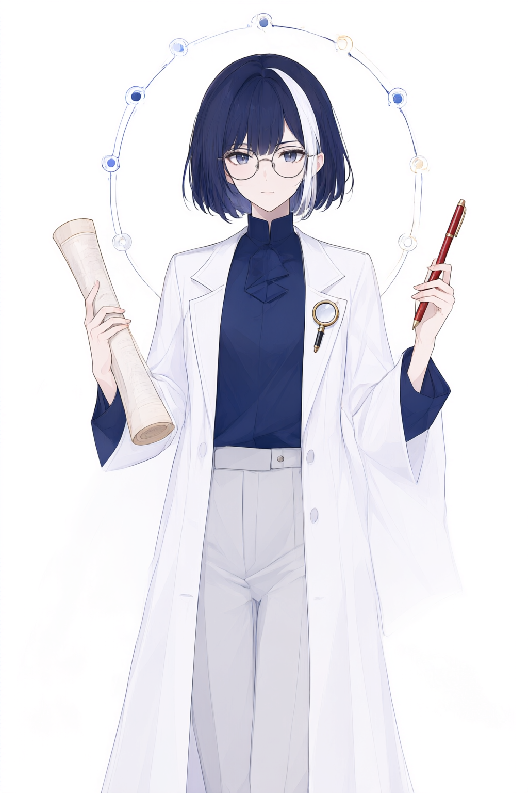

# Live2D 拟人形象设定（方案 A 定稿）

> 参考图：`C:\code\兴智杯\兴智杯\GPT龙娘.png`（实际是 AVIF，扩展名写成了 .png）。
> **只借画风，不照抄角色**：不用参考图的龙角、龙尾、翅膀、白紫礼服和脸。
> 本文是「立绘 → 拆层 → Live2D Cubism 绑定」的制作设定，不是已经绑好的 `.moc3`。

---

## 一、参考画风拆解（只取这部分）

- **线稿**：极细、偏冷的线，轮廓轻、内部结构线更轻；不要粗黑描边。
- **上色**：柔和赛璐璐，色块干净、边缘清晰；不厚涂、不强渐变。
- **细节**：细节集中在衣领、胸针、袖口、纸卷等小面积；脸和身体保持干净。
- **气质**：清冷、安静、书卷气，不热闹、不卖萌。
- **构图**：正面、对称、纯白底，方便拆层。

## 二、角色设定（方案 A）

| 项 | 设定 |
|---|---|
| 名字 | **知微**（见微知著；备选：小书、格物） |
| 身份 | 「DeepSeek AI4S 科学智能体」的首席研究助手 |
| 年龄感 | 20 岁出头，清冷、聪明、不幼稚 |
| 外观 | 年轻女学者，齐耳深藏青短发（bob）+ 一缕纸白挑染；深藏青瞳孔 |
| 眼镜 | 细圆框，镜片有很淡的放大镜高光 |
| 服装 | 白色大褂 + 深藏青立领衬衫（配深藏青领巾/折角领）+ 浅灰长裤；藏青袖口 |
| 标志物 | 放大镜胸针、纸卷、红色审稿笔；背后一圈九步闭环细线 |
| 姿态 | 正面、对称、双臂自然离开身体，双手可见；不抱臂、不交叠 |
| 背景 | 纯白，无投影、无渐变 |
| 配色 | 深藏青 `#1A2A6C`、钴蓝 `#2D4373 / #4F7DF3`、纸白 `#FAFCFF`、浅灰 `#E9EDF4`、少量暖金 |
| 禁止 | 龙角、龙尾、翅膀、淡紫礼服、白裙、铠甲、厚涂、3D、深色背景、画面文字 |

> 这一版是**人类学者**，不是龙娘；只保留参考图的极细线稿和柔和赛璐璐。

---

## 三、定稿提示词

### A. 英文（当前定稿用的版本）

```text
Use the attached image ONLY as an art-style reference: ultra-fine lineart, delicate Japanese anime
character illustration, soft cel shading, clean flat-color regions, ethereal elegant mood, plain
paper-white background. Do NOT copy the reference character's face, long white hair, glasses shape,
horns, tail, dress, silhouette or pose.

Create ONE original Live2D-ready character illustration for the Chinese AI science agent
"DeepSeek AI4S 科学智能体": a calm, sharp-eyed young female scholar in her early 20s, clearly feminine
features, short chin-length deep-navy bob with one paper-white streak, thin round glasses with a faint
magnifying-glass glint, a crisp white lab coat over a deep-navy high-collar shirt with a deep-navy
necktie/cravat, light-gray trousers, a small magnifying-glass brooch, a folded paper scroll in one hand
and a slim red review pen in the other. A subtle nine-node circular workflow motif floats behind them as
a thin navy line; no other floating props.

Front-facing, perfectly symmetrical, neutral standing pose, waist-up to mid-thigh composition, arms
slightly away from the torso, hands relaxed and clearly visible, calm confident expression, looking at
viewer, clean silhouette, isolated on a plain paper-white background.

Color palette: deep navy #1A2A6C, cobalt #2D4373 and #4F7DF3, paper white #FAFCFF, light gray #E9EDF4,
a tiny warm gold accent. Strictly NO lilac clothing, NO lavender dress, NO white gown.

High-resolution 2D anime illustration, crisp ultra-fine lineart, soft cel shading, clean flat-color
regions suitable for Live2D layer separation, official character reference art, no text, no watermark,
portrait 2:3.
```

### B. 中文版（Seedream / 通义万相 / 即梦）

```text
只参考附图的艺术风格：极细线稿、精致日系动画角色插画、柔和赛璐璐、色块干净、清冷书卷气、纯白背景。
不要复制参考角色的脸、白色长发、眼镜形状、龙角、龙尾、礼服和姿势。

原创角色「DeepSeek AI4S 科学智能体」：20 岁出头的年轻女学者，齐耳深藏青短发（bob）+ 一缕纸白挑染，
深藏青瞳孔，细圆框眼镜，白色大褂 + 深藏青立领衬衫（配深藏青领巾/折角领）+ 浅灰长裤，藏青袖口，
放大镜胸针，一手纸卷、一手红色审稿笔，背后一圈细线九步闭环，没有其它悬浮物。

正面，完全对称，自然站姿，膝上构图，双臂自然离开身体，双手放松可见，平静自信，看向镜头，
轮廓干净，纯白背景。配色：深藏青、钴蓝、纸白、浅灰、少量暖金；不要淡紫衣服、不要白裙。
极细线稿、柔和赛璐璐、色块干净、适合 Live2D 拆层，无文字、无水印，竖版 2:3。
```

### C. 负面提示词

```text
long white hair, white hair, dragon horns, dragon tail, wings, white ballgown, lace dress,
lavender clothing, lilac dress, fantasy armor, 3d, realistic, photorealistic, dark background,
gradient background, text, letters, watermark, logo, signature, extra fingers, deformed hands,
bad anatomy, multiple views, turnaround, expression sheet, props covering the face, thick black outlines
```

### D. 生成参数

| 项 | 建议 |
|---|---|
| 模型 | DashScope / Qwen-Image 3.0（本次）或其他可用的图生图模型 |
| 比例 | 2:3 竖版（1024×1536） |
| 背景 | 纯白，无阴影 |
| 参考图 | 只用线稿/上色/气质；不要让模型照着画角色 |
| 文字 | 不让模型画字，后期叠 |

---

## 四、Live2D 制作规格

### 1. 画布与导出

- 源 PSD：`4096 × 4096`（或 `3000 × 4500` 竖版）。
- 纹理图集：`4096 × 4096`；移动端可出 `2048 × 2048`。
- 导出：`.moc3` + `texture_00.png` + `physics3.json` + `model3.json` + motion。
- 不烘焙阴影、不合并背景；所有部件透明底。

### 2. 图层顺序（从后到前）

```text
back_hair
halo_nine_nodes          # 九步闭环细线，独立层，可开关/旋转
body_base
trousers
shirt
coat_back
arms_L / arms_R
neck
face_base
eye_white_L / eye_white_R
iris_L / iris_R
pupil_highlight_L / pupil_highlight_R
eyelash_L / eyelash_R
eyebrow_L / eyebrow_R
mouth_inner / tongue / teeth
mouth_line
nose
blush / cheek
front_hair
ahoge
hair_streak_white
glasses_frame / glasses_lens (可开关)
brooch_magnifier
coat_front / lapels / buttons
collar
sleeves_L / sleeves_R / cuffs
hands_L / hands_R
props:
  paper_scroll           # 纸卷，独立层
  red_pen                # 红笔，独立层
```

### 3. 建议参数

| 参数 | 用途 |
|---|---|
| `ParamAngleX/Y/Z` | 头部左右/上下/倾斜 |
| `ParamBodyAngleX/Y/Z` | 身体朝向 |
| `ParamBreath` | 呼吸 |
| `ParamEyeLOpen/ROpen` | 眨眼/闭眼 |
| `ParamEyeBallX/Y` | 眼球看向 |
| `ParamBrowLY/RY` | 眉毛 |
| `ParamMouthOpenY` / `ParamMouthForm` | 张嘴/口型 |
| `ParamHairFront/Back` | 短发前后摆动 |
| `ParamAhoge` | 挑染/呆毛 |
| `ParamGlasses` | 眼镜开关（自定义） |
| `ParamHalo` | 九步光环显示/旋转（自定义） |
| `ParamPropPaper` / `ParamPropPen` | 道具显示/隐藏（自定义） |
| `ParamArmLA/RA` | 手臂（自定义，按拆层方式加） |

物理：短发、衣摆、领口、袖口；眼镜和胸针跟脸/胸绑定，不做物理；光环慢速旋转，不做物理。

### 4. 表情与口型

- 本次**不做表情差分图**；正式绑定时用标准参数做：眼开/闭、眉平/微皱、嘴闭/微张，
  再按需要加 A/I/U/E/O 五套口型。
- 如果以后接入聊天状态，先加「思考」「认真」「浅笑」三套即可，不追求表情数量。

### 5. 给拆层师的一句话

> 这是一个 **Live2D 膝上立绘**项目：请按上面的图层表拆成透明 PSD；头发、大褂、衬衫、手、
> 纸卷、红笔、眼镜、九步光环全部分层；不要合并阴影，不要让道具挡住脸和胸前；线稿保持极细冷灰/淡紫灰，
> 色块尽量平涂。

---

## 五、接入项目的方式

1. **定稿**：用 `docs/assets/live2d/知微-方案A立绘.png` 这一张。
2. **清理**：放大到 4096 画布，补全被手/纸卷遮住的衣领、袖口和腰线。
3. **拆层**：按上面的图层表拆 PSD。
4. **绑定**：Cubism 做参数 → 物理 → 口型 → 导出 `.moc3`。
5. **网页接入**：Cubism SDK for Web 或 `pixi-live2d-display`，先做右下角可开关的小助手。
6. **授权**：Cubism SDK 有独立许可条款；比赛/非商业通常可用免费档，商用前确认。

---

## 六、定稿立绘



生成：DashScope / Qwen-Image 3.0，`1024 × 1536`，2026-10-23。

- 年轻女学者、齐耳深藏青短发（bob）+ 纸白挑染、细圆框眼镜；
- 白大褂 + 藏青立领衬衫 + 浅灰长裤，放大镜胸针、纸卷、红笔；
- 背后九步闭环细线，纯白背景；
- **只有两只手**：一手纸卷、一手红笔；拆层时袖口/手腕单独成层再修；
- 没有龙角、龙尾、翅膀、淡紫礼服；只借参考图的极细线稿和柔和赛璐璐。

> 早期龙娘礼服方向的探索图没有保留，只作画风参考，不作为定稿。
> **表情差分按你的要求暂不做。**

---

## 七、下一步

1. 先确认这张立绘：要调只改发型长度/性别/外套长度，不改画风。
2. 清理并放大到 4096 画布，补全遮挡结构。
3. 按第四节拆层，交给 Cubism 绑定。
4. 绑定完成后接入网页右下角，先做「待机 / 思考 / 认真」三个状态。
